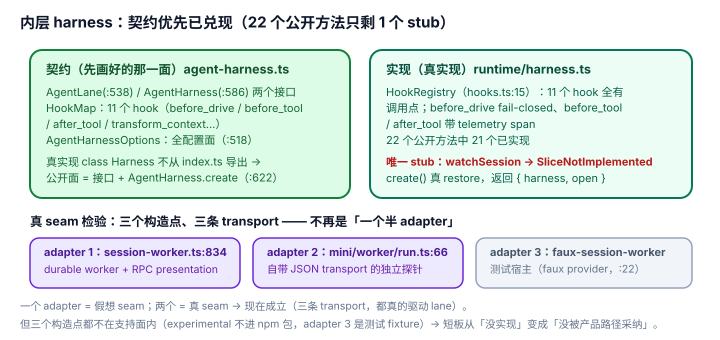

# 2.3 内层 harness：契约优先以"整体迁出 pi-agent-core"收官——durable 事实承接，短板仍是"只被 experimental 消费"，且换了宿主包

> **基线**：pi-mono `v1.0.0`（upstream `7fbbd5f4a` = tag+2，merge `9e387e653`），源码锚点对应工作树。**版本史**：2026-09-10（v0.85.1）整篇重写，立论是"契约优先已兑现，短板从'没实现'换成'只被 experimental 消费 + 契约仍在重画'"；**v1.0.0（2026-10-02）按新现实再改写**——7fd478a2e 把 `AgentHarness`/`AgentLane` 契约与实现整体移出 pi-agent-core（单笔 −105k），`packages/durable` 的 `Harness` 事实承接（per-conversation agents、task graph、lifecycle conformance）。旧文引用的 `packages/agent/src/harness/**` 锚点全部随之失效。背景见 [`../../_change_log/0007-v0.86.1-to-v1.0.0.md`](../../_change_log/0007-v0.86.1-to-v1.0.0.md)。

## 现象是什么

v0.85.1 的现象（"22 个公开方法只剩 1 个 stub、三个构造点"）在 v1.0.0 整体不复存在——不是被推翻，是**毕业了**：

- **pi-agent-core 收缩为最小核**：`src/` 只剩 6 个文件（agent / agent-loop / proxy / stream-fn / types / index），`index.ts` 5 行（`:1-5`），exports 只剩 `.` 与 `./package.json`；`grep -rn Harness packages/agent/src` **零命中**。CHANGELOG 1.0.0 Breaking 条目原文："Removed the experimental harness … Use `@earendil-works/pi-durable` for durable sessions."（`packages/agent/CHANGELOG.md:9`）
- **`packages/durable` 接盘**：`src/harness/` 21 个文件（全包 60 个 .ts）；`Harness` 是"类型别名 + 工厂对象"——`export type Harness = HarnessType`（`harness/harness.ts:443`）、`export const Harness = { open }`（`:445`），`Harness.open(storage, options, context)`（`:447-451`）打开持久 harness，实现类 `HarnessImpl`（`:169`）不导出。durable 是**独立 workspace 包**：自带 `./storage/memory|jsonl|sqlite`、`./env`、`./tools`、`./testing` 子路径导出，不依赖 pi-agent-core。
- ~~**消费者全部在 coding-agent 的 `src/experimental/`**~~：~~experimental durable TUI（`experimental/durable/runtime.ts:138`）、vacation demo（`experimental/vacation/runtime.ts:135`）、client/server worker（`experimental/session-worker.ts:784`，经 `createCodingAgentHarness` `:773`），外加测试 fixture `test/fixtures/faux-session-worker.ts:24`~~。

> **⚠️ v1.2.0：上面这条"消费者清单"已整体作废（sync 0009）**。`7472cda0d` 删除了 `packages/coding-agent/src/experimental/` 的几乎全部内容（只有 `source-resolver.ts` 存活），上述**四个路径全部不存在**（`experimental/durable/runtime.ts`、`experimental/vacation/runtime.ts`、`experimental/session-worker.ts`、`test/fixtures/faux-session-worker.ts` 均已在 v1.2.0 缺失）。
>
> 更强的更正：**`packages/coding-agent` 在 v1.2.0 已完全不依赖 pi-durable**（`package.json` 零 `pi-durable` 依赖），`grep -rn "Harness.open(" packages/coding-agent/src` 在 v1.2.0 返回**零命中**。因此本页"durable 的消费者只在 experimental"这一论断的对象**已不存在**——durable 现在是独立自洽的包，它的消费者是 `packages/env` 与直接使用 `@earendil-works/pi-durable` 的外部调用方。
>
> 本页余下的**契约本身**（`Harness` 类型别名 + 工厂对象、`Harness.open(storage, options, context)`、`HarnessImpl` 不导出、子路径导出表）经 v1.2.0 复核**仍然成立**，只是"谁在用"这半页需要按此重读。

## 核心矛盾是什么

1. **"library-first 的第二层"换了宿主包。** v0.85.1 的评价对象是 `packages/agent` 包内的 harness；v1.0.0 起内层 harness 的契约与实现都住在 `@earendil-works/pi-durable`。"agent 包级嵌入"这个字面承诺不再由 agent 包兑现——要么用最小核 `Agent` 自己组装，要么把 durable 作为独立依赖引入。
2. **"能跑" vs "被支持"没有变。** durable Harness 的三个真实消费者全在 `src/experimental/`（npm `files` 排除 `dist/experimental`），产品路径 `core/sdk.ts` 的 `createAgentSession()`（`:175`）对 pi-durable **零引用**（grep 确认 `src/core/` 无 pi-durable import）。
3. **承接包自己声明没有契约。** durable README 顶部原文："**Experimental.** The API changes without notice between releases."（`README.md:3`）；CHANGELOG 在 1.0.0 重置为单一 "Initial release" 条目，0.87.0–0.99.2 的 16 条 Breaking 只存 git 历史——[2.4](./2.4_no_version_contract.md) 的成本在承接包上原样复刻。

## 设计判断是什么

### 判断一：契约优先的收官形态是"毕业"，不是"定居"（硬事实 + 解释）

v0.85.1 的判断——"契约导出、实现不导出"的 seam 形状——在 v1.0.0 推出了第三幕：**连导出面都不再留在核心包里**。7fd478a2e 一笔删除 `packages/agent/src/harness/**`（101 文件 / 28.7k 行）与全部 harness 测试（76 文件 / 24.6k 行），消费者在**同批 commit** 里切到 pi-durable（48dd1e2f0 把 experimental client/server worker 与 durable TUI 迁到 pi-durable）。删除检验通过的方式是"删完之后 seam 还在，只是换了地址"：`Harness.open()` 依然是唯一公开构造口（`harness/harness.ts:409`，实现类 `:164` 不导出——v0.85 的形状原样保留），三个构造点照常工作。

**deletion test 这次是反向的**：v0.85.1 说"删掉 `AgentHarness`，experimental 的 durable 执行基座整个消失"；v1.0.0 证明这件事的代价可以由**包边界**吸收——agent 包 Breaking 一条、下游迁移指向一个新包名，核心包其余部分无感。

### 判断二：durable 承接的不只是实现，承接面比 v0.85 的 AgentHarness 更大（硬事实）

- **per-conversation agents**：`Conversation.agent()/configure()`（`harness/harness.ts:91`/`:95`）；agent 状态是可回溯的内置文档 `pi.agent`（`AgentDoc`，`harness/agent.ts:36`），`resolveSettings` 合并重试/压缩/steering 默认值（`agent.ts:47`）。
- **task graph 与结构化并发**：`Harness.taskGraph()/watchTaskGraph()`（`harness/harness.ts:296`/`:300`），`TaskGraphView`（`harness/task-graph.ts:62`）；abort 级联与 `completing` hold（`harness/scheduler.ts:167-171`）、compaction 作为内置任务（`CompactionTask` `harness/compaction.ts:102`、`selectCut` `:253`）。
- **扩展制**：`defineExtension` 等（`harness/define.ts:6-43`）、`Extension`（`harness/types.ts:257`）、registry 按名 install/uninstall（`harness/registry.ts:73`/`:82`）。
- **契约钉在测试与规格上**：lifecycle conformance（`test/harness-lifecycle.test.ts`，613 行）、spec-usage（`test/spec-usage.test.ts`，380 行）、storage conformance（`src/testing/storage-conformance.ts`，1,583 行）；normative 规格 `docs/spec.md`（4,601 行）在仓库里。

### 判断三：三条短板——位置变了，性质没变（硬事实 + 评价）

1. **只被 experimental 消费。** 消费者三处全在 `src/experimental/` + 一个测试 fixture；`files` 排除 `dist/experimental`，消费者进不了安装闭包；产品路径零引用。与 v0.85.1 相比，唯一变化是"experimental 消费的东西"从 agent 包的 `AgentHarness` 换成 durable 的 `Harness`——"没被产品路径采纳"这条短板**原样迁移**。
2. **接入成本从"包内子路径"变成"跨包依赖"。** v0.85.1 消费内层 harness 只需要 agent 包的子路径导出；v1.0.0 起要新增 `@earendil-works/pi-durable` 依赖及其 storage/env/tools 面。对想自组 harness 的宿主，这是真实的依赖面扩张——换来的是 harness 与最小核解耦演进。
3. **无版本契约，且承接包自认。** durable README 第一行就是 "The API changes without notice between releases"；CHANGELOG 重置抹掉了迁移历史；`HarnessOptions`/registry 体系在 v1.0.0 发布窗口内被整体替换（b56702ad3，Package 21：`harness/config.ts` 删除、registry 收敛为扩展安装制）就未被记为 Breaking。v0.85.1 说"契约兑现得越彻底，契约变化的成本越高"——如今契约连同一份变更史都被重置了。

**severity 分层（本节规则）**：自用 / CLI·TUI 产品路径 = **无影响**（那条路走 `createAgentSession()`，v0.85.1 → v1.0.0 该面未变）；想用 durable 自组 harness 的宿主 = **中**（能跑、有规格与 conformance，但 API 自述 Experimental，得跟着 repo 走）；把 durable Harness 当长期依赖做产品的 = **高**（README 明说 "changes without notice"，CHANGELOG 无历史）。

**缓解路径（本节规则）**：pi 留的口子比 v0.85 更实——`docs/spec.md`（normative，4,601 行）+ lifecycle/spec-usage/storage 三套 conformance 是可核对的契约文本；`experimental/durable/harness-setup.ts`（123 行，`createHarnessSettings` `:25`）是一个"宿主怎么装配 Harness"的真实范例。范例与规格仍 ≠ 兼容承诺。

## 影响是什么

1. **library-first 选型结论再改一次**："agent 包级嵌入 = 未来可直用"（旧）→ "契约在 agent 包内兑现"（v0.85.1）→ **"内层 harness = 独立包 pi-durable，experimental 级支持"（v1.0.0）**。嵌入诉求的直接答案是 `Harness.open()` + durable 文档，不是 agent 包。
2. **和 [2.4](./2.4_no_version_contract.md) 的联动换了宿主**：无版本契约的短板现在钉在 durable 上，而且 durable 自己就是"无变更史"的样本（1.0.0 CHANGELOG 重置为 "Initial release"）。
3. **"契约优先"策略的最终证据**：三轮重画（v0.83 泛型 → v0.84 lane 骨架 → v0.85 真实现）之后不是第四轮重画，而是**整体迁出核心包**——seam 的形状（工厂构造、实现私有）穿越三次搬迁保持不变。这延伸了旧文判断四的 design-it-twice 结论，只是兑现方式（迁包）超出当时预期；`types.test.ts` 的接口不重叠断言随 `packages/agent/test/harness/` 一起成为历史。

## 源码锚点是什么

- `packages/agent/CHANGELOG.md`：1.0.0 Breaking 条目（harness 全删、迁移指向 pi-durable）（`:9`）
- `packages/agent/src/index.ts`：5 行导出面（`:1-5`）；`packages/agent/package.json` exports 仅 `.` + `./package.json`
- `packages/durable/src/harness/harness.ts`（**v1.2.0 实测 470 行**）：`HarnessImpl`（`:169`）、`export type Harness`（`:443`）、工厂 `export const Harness`（`:445`）、`Harness.open()`（`:447-451`）、`Conversation.agent()/configure()`（`:95`/`:99`）、`taskGraph()/watchTaskGraph()`（`:307`/`:311`）。**订正（2026-10-14 轮次 0013）**：原引 `:164/405/407/409/91/95/296/300` 是 v1.0.0 的旧行号，在 v1.2.0 全部错位
- `packages/durable/src/harness/agent.ts`：`AgentDoc`（`:43`，**原引 `:36`**）、`resolveSettings`（`:57`，**原引 `:47`**）
- `packages/durable/src/harness/task-graph.ts`：`TaskGraph`（`:44`）、`TaskGraphNode`（`:30`）、`TaskGraphView`（`:62`）
- `packages/durable/src/harness/compaction.ts`：`CompactionTask`（`:110`，v1.0.0 时为 :102）、`selectCut`（`:262`）；`harness/scheduler.ts`：abort 级联 / `completing` hold（`:167-171`）
- `packages/durable/src/harness/define.ts`：`defineExtension/defineTool/section/hook/wrapTool/wrapSection`（`:6-43`）；`harness/types.ts`：`Extension`（`:365`）；`harness/registry.ts`：`install/uninstall`（`:73`/`:82`）
- `packages/durable/test/harness-lifecycle.test.ts`（614 行）、`test/spec-usage.test.ts`（380 行）、`src/testing/storage-conformance.ts`（1,663 行，v1.0.3 时为 1,583）
- `packages/durable/README.md`：顶部 "**Experimental.** The API changes without notice between releases."（`:3`）；`docs/spec.md`（5,340 行，npm 不随发）
- ~~消费者清单：`packages/coding-agent/src/experimental/durable/runtime.ts:138`、`experimental/vacation/runtime.ts:135`、`experimental/session-worker.ts:773`（`createCodingAgentHarness`）/`:784`（`Harness.open`）、`test/fixtures/faux-session-worker.ts:24`；共享装配 `experimental/durable/harness-setup.ts`（`createHarnessSettings` `:25`）~~ —— **v1.2.0 全部不存在**（`7472cda0d` 删除 `src/experimental/` 至仅剩 `source-resolver.ts`；5 条路径已逐条对 tag 确认缺失）。**本条属 v1.0.0 事实，勿作现状引用**，与上方横幅同源
- 产品路径对照：`packages/coding-agent/src/core/sdk.ts` 的 `createAgentSession()`（`:191`，**原引 `:175`**）——`src/core/` 对 pi-durable 零引用
- 已删除符号的墓碑（**不要作为现状引用**）：`AgentHarness`/`AgentLane`（pi-agent-core，`AgentLane` 全仓源码零命中）、`packages/agent/src/harness/**`、`packages/agent/test/harness/**`（含 `types.test.ts`）、`packages/agent/docs/harness.md`、`experimental/mini|micro`

## 最小例证是什么

**例证 1（最小核）：** `ls packages/agent/src` → 6 个文件；`grep -rn Harness packages/agent/src` → 零命中；`packages/agent/package.json` 的 exports 只剩两条。证明 CHANGELOG 原文 "The package now contains only `Agent`, the agent loop, the proxy stream, and their types."

**例证 2（事实承接 + 消费面）：** ~~`grep -rn "Harness.open(" packages/coding-agent/src` → 三处（durable TUI `:138`、vacation `:135`、session-worker `:784`），全部 import 自 `@earendil-works/pi-durable`；`grep -rln pi-durable packages/coding-agent/src` → 命中全部落在 `src/experimental/`。~~ **v1.2.0 该例证已失效**：`packages/coding-agent/src/core/` 与全部 `src/` 对 pi-durable **零引用**，承接关系只剩 durable 作为独立库（消费者是 `packages/env` 与外部 SDK 用户）。证明承接成立这一点仍有效，**"消费仍限 experimental"已不成立**。

**例证 3（承接包自认无契约）：** `packages/durable/README.md:3` → "**Experimental.** The API changes without notice between releases."；`packages/durable/CHANGELOG.md` 1.0.0 只有一条 "Initial release"。证明 [2.4](./2.4_no_version_contract.md) 的短板在承接包原样存在。

可观察信号：例证 1 → 核心包不再承载 harness；例证 2 → durable 是事实承接、消费仍限 experimental；例证 3 → 支持级别与兼容承诺没有提升。三者同成立，才能说"契约以迁包收官，短板换了宿主而没消失"——而不是笼统说"harness 问题解决了"。
