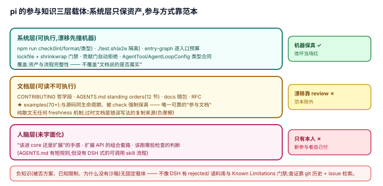

# 5.1 知识外置:pi 把"如何正确参与"放在了哪一层

## 现象是什么

参与 pi 需要的知识分散在三层载体上。**系统层**(可执行、漂移先撞机器):`npm run check` 聚合的 lint/format/类型检查与逐入口模块图预算(`scripts/check-entry-graphs.mjs`,`AGENTS.md:32`)、`./test.sh` 的 e2e 隔离规则(`AGENTS.md:34`)、pre-commit 的 lockfile 门禁与 install-lock 生成校验(`AGENTS.md:43-51` 节;install-lock 自 v1.0.1 起取代已删除的 npm-shrinkwrap,机制不变:pre-commit 门禁 + 生命周期脚本 allowlist)、贡献门的自动拒绝(CI/工作流,见 [3.3](../03-Discipline/3.3_contribution_gate.md))。**文档层**(可读不可执行):`CONTRIBUTING.md` 的哲学第一段(`CONTRIBUTING.md:7-11`)、`AGENTS.md` 的 standing orders(12 个小节,`AGENTS.md:1-123`)、随包 README/docs([4.3](../04-Self-Description/4.3_docs_in_package.md) 已核)、examples 范本(70+)。**人脑层**(未字面化):"哪个能力该进 core 还是扩展"的具体手感、扩展 API 的组合套路、选哪些 gate 跑的判断。

## 核心矛盾是什么

外置程度与维护税成正比:系统层每加一道门禁都是一个要养活的新脚本;文档层每条规则都可能漂移且无机器核对;推到人脑层最省事,但代价由每一个新参与者(尤其 coding agent)支付。pi 的选择是**取舍而非全外置**——这与 DSH"关键规则尽量下沉到系统层"的立场是同一光谱上的两个点,不是对错之分(判断,[框架] 借鉴自 DSH harness-idea 07 的"外置程度 ÷ 外置成本")。

## 设计判断是什么

### 判断一:系统层覆盖了"资产完整性",几乎不覆盖"参与方式"(硬事实 + 解释)

逐条看 pi 的机器检查:`check`(lint/format/type/entry-graph)、`test.sh`(测试隔离)、lockfile/install-lock 门禁(供应链)、贡献门(流程)——全部是**资产与流程完整性**检查。参与方式的知识("怎么写一个扩展""事件怎么选""工具 prompt 契约怎么写")没有任何一道机器门禁,只有 [4.2](../04-Self-Description/4.2_tool_prompt_contract.md) 那样的结构性自源(promptSnippet 兼作闸门)和 [1.4](../01-Architecture/1.4_lifecycle_guards.md) 的运行时护栏。

**这是 pi 与 DSH 最清楚的分界线**:DSH 的 `verify-export-jsdoc`、doc-typecheck、生成目录把"合同写成什么样子"也机器化了;pi 的系统层不碰"文档说的是否属实"。pi 由此省下整套文档门禁的维护税,代价是文档漂移只能靠 review 抓——这条边界在 [2.4 无版本契约](../02-Boundaries/2.4_no_version_contract.md) 已从扩展稳定性角度判过,本页补的是同一选择的另一面。

### 判断二:examples 承担了"参与知识的主要外置",是文档层里最不漂移的部分(硬事实 + 解释)

70+ 个扩展范本与源码同生命周期:API 改了,`npm run check` 会直接红——**examples 是 pi 唯一被系统层强制保真的"参与文档"**。相比之下纯散文(`docs/`、README 段落)无任何 freshness 机制。推论:在 pi 里找"正确参与姿势",范本比散文可靠;这个事实决定了 5.3 的摩擦差分析。

### 判断三:负知识基本没有外置(硬事实 + 解释)

被否掉的方案、已知限制、"为什么没有沙箱/没有版本契约"的理由,分散在 CONTRIBUTING 的哲学段、containerization 文档与 RFC 里;没有 DSH `rejected/` note 语料库或 README Known Limitations 门禁那样的固定载体。coding agent 或新贡献者查"这条路是否已被否掉"要靠 git 历史与 issue 检索——**负知识停留在最不外置的形态**(判断,可证伪:若 pi 未来引入 limitations 门禁或 rejected 载体,本判断失效)。

## 影响是什么

1. **对 agent 参与者**:读 pi 的正确姿势是"跑 check + 抄 examples + 查 AGENTS.md",散文只做索引;这与 [`agent/`](../../agent/) 消化材料的实际用法一致。
2. **对维护者**:文档层漂移是已知的、被接受的风险;任何"加文档门禁"的提议实质上是在重新划 5.1 判断一那条分界线,值得按 DSH 的成本表([框架] 参考)算维护税。
3. **对评估 pi 作为嵌入引擎**:SDK 契约(`createAgentSession`,`coding-agent/src/core/sdk.ts:146`)有系统层保真(类型检查);嵌入式参与知识的保真依赖宿主自己维护。

## 源码锚点是什么

- `AGENTS.md:30-51`:Commands 与 Dependency 节——系统层检查的 standing orders
- `scripts/check-entry-graphs.mjs:3,36`:逐入口预算(已在 [3.1](../03-Discipline/3.1_core_minimal.md) 判断五核;行号按 v1.0.0 现树)
- `CONTRIBUTING.md:7-11`:文档层的哲学第一段
- `packages/coding-agent/src/core/sdk.ts:175`:`createAgentSession` 有类型保真的嵌入契约
- `packages/coding-agent/examples/extensions/`:70+ 范本(判断二的物证)

## 最小例证是什么

**例证 1(分层读数)**:故意把 `docs/` 里一段描述改错——没有机器会红;把 `examples/extensions/todo.ts` 的参数改错——`npm run check` 红。两分钟可验证,直接证明判断一与判断二。
**例证 2(负知识)**:在仓库内搜 "sandbox",能找到 containerization 文档与 [2.1](../02-Boundaries/2.1_no_sandbox.md) 的分析,但找不到"该方案曾被考虑并否决"的固定载体——负知识未外置的直接观察。
