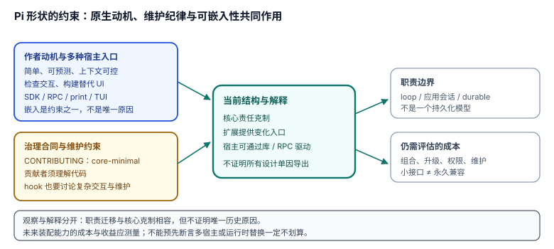

# 5.2 形状的因果：极简核、扩展面与可嵌入性

> **局部复核锚点**：`cb18c7cbc89d5becbb4ea2e490a6e7ad0e989f04`。本页是多个事实支持的设计解释，不是单因证明。分析框架的历史出处见 [方法声明](README.md)。

## 现象是什么

- [贡献哲学](../../../CONTRIBUTING.md#philosophy)要求 core-minimal，同时允许经过讨论的核心与 hook 改动。
- [扩展合同](../../../packages/coding-agent/docs/extensions.md)为工具、事件、命令、UI、provider 等变化提供入口。
- [README](../../../README.md#pi)同时提供 TUI、print/JSON、RPC、SDK；本文将可作为库驱动的结构概括为 library-first，不声称它是官方逐字产品优先级。
- [v1.0.0 同步记录](../../_change_log/0007-v0.86.1-to-v1.0.0.md)记录 agent 包内层 durable/harness 能力迁出；应用层 JSONL 会话仍由 [SessionManager](../../../packages/coding-agent/docs/sdk.md#sessionmanager-api)管理。

## 核心矛盾是什么

核心承担越多产品工作流，宿主就越容易继承自己不需要的决定；扩展入口越多，交互与维护成本也可能越高。[CONTRIBUTING:11](../../../CONTRIBUTING.md#L11)直接警告后者。因此，**核心克制与扩展深度要一起评估**，不是“稳定性与可组合性只能二选一”。

## 设计判断是什么

### 1. 可嵌入性是约束之一，不是全部原因

[作者自述](https://mariozechner.at/posts/2025-11-30-pi-coding-agent/)确实希望在 agent core 上构建替代 UI。小而可理解的运行核与显式 API 有利于这一目标，这是合理解释。

同文还给出其它动机：控制上下文、避免额外任务状态、观察计划与代理过程、个人工作流偏好。**不能把无内置沙箱、无统一计划或无 API 版本保证都归因于“嵌入压力不需要”。** 特别是嵌入者通常也需要安全策略与升级兼容，只是这些问题由哪些层承担，需要另行论证。

### 2. 维护纪律与结构相互支持，但不证明全部历史因果

[CONTRIBUTING](../../../CONTRIBUTING.md#the-one-rule)要求贡献者理解改动；其 [贡献门解释](../../../CONTRIBUTING.md#why-are-new-issues-and-prs-auto-closed)说明 review 能力是限制。[README:100](../../../README.md#L100)将项目规则适用于人和 agent；不是 AGENTS 开篇明示，也不是 README 要求 agent 自我解释。

core-minimal 可以减少必须由维护者承担的能力面，这是解释。它不意味着“扩展 PR 不受 review”，不证明实际开发者比例，也不支持无数据的“单维护者/成本低一个数量级”结论。

### 3. 职责迁移支持模块边界解释，不证明 API 永久稳定

agent 包与 durable 的职责分离可让宿主选择所需层；但 [durable README](../../../packages/durable/README.md)明确 experimental、API 可随版本变化。[版本契约分析](../02-Boundaries/2.4_no_version_contract.md)也提醒不要将类型合同误当跨版本兼容承诺。

应表述为“**职责较小、入口可检查**”，而不是“API 稳定且小”。一次迁移与 core-minimal 相容，不足以证明演进必然单调，也不证明未来所有核心变化都是错误方向。

## 影响是什么

1. **嵌入选层**：基础 loop、coding-agent session API、独立 durable 的成本与恢复合同不同，先决定需要哪一层。
2. **功能归属**：先核对是否属于核心责任，再查扩展或宿主入口；不要用“可嵌入”一词否定安全、兼容和编排需求。
3. **未来复核**：若引入新的运行时装配或会话装卸能力，应测量复杂度与收益，不能预先断言它一定导致成本超过收益。当前 [扩展文档](../../../packages/coding-agent/docs/extensions.md#understand-the-runtime-lifecycle)已有 reload 合同，也不能笼统说“无运行时替换”。

## 最小例证

- 用 SDK 驱动 `AgentSession`，使用的是应用会话合同；直接运行独立 durable Harness，使用的是另一套持久任务合同。两者可嵌入，但不是同一状态模型。
- 新增扩展 hook 时，贡献规则要求讨论可维护性。说明 Pi 不是只追求扩展点数量，也不是拒绝任何核心演进。
