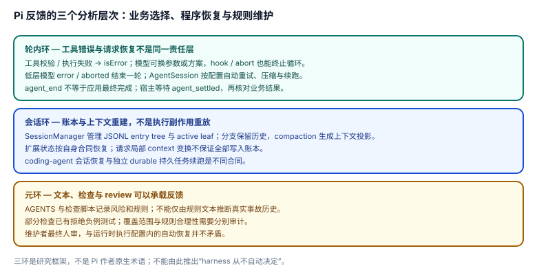

# 5.4 反馈三环：失败信号、会话恢复与规则维护

> **局部复核锚点**：`cb18c7cbc89d5becbb4ea2e490a6e7ad0e989f04`。三环是研究视角，历史出处见 [方法声明](README.md)，不是源码中三种命名的运行时对象。

## 现象是什么

可从三个层次观察反馈：工具/模型请求中的失败信号，会话持久化与上下文恢复，仓库规则与检查的维护。**模型业务选择、宿主政策与程序自动恢复同时存在**，不能概括成“harness 永远只报告、不裁决”。

## 核心矛盾是什么

上下文预算与事实保留、恢复便利与副作用安全都需要取舍。Pi 保留会话条目、生成派生上下文，也执行配置内的自动重试。没有证据证明这些选择在所有情况都偏向同一端。

## 设计判断是什么

### 1. 轮内环：区分工具业务错误与请求基础设施恢复

[E009](../../_evidence/render.md#e009)把未知工具、参数校验失败和拦截转换为 `isError`；工具执行错误也按工具结果合同返回。模型可据此选择新参数或新方案，但 hook 的 terminate、abort 和 turn 决策可以停止或改变循环，不能说失败永远不断循环。

[E010](../../_evidence/render.md#e010)对模型 `error`/`aborted` 结束这一轮；截断响应的工具调用则判失败，不执行可能不完整的参数。

**应用层不是同一合同**：[E011](../../_evidence/render.md#e011)在低层结束后处理续跑；[E012](../../_evidence/render.md#e012)按配置进行指数退避。当前 [retry 设置](../../../packages/coding-agent/docs/settings.md#network-and-retries)默认开启 agent-level retry，最多 3 次；自动压缩与溢出恢复也可能继续工作。

集成上的直接后果：等待 [`agent_settled`](../../../packages/coding-agent/docs/extensions.md#understand-the-runtime-lifecycle)，不要把 `agent_end` 当应用级最终完成。

### 2. 会话环：重建上下文，不等于重放所有执行

[SessionManager 合同](../../../packages/coding-agent/docs/sdk.md#sessionmanager-api)负责持久/内存 entry tree、active leaf、分支与压缩投影；[session-format](../../../packages/coding-agent/docs/session-format.md)记录消息与 prompt/tool 声明变化。扩展可用 custom entry 或工具结果 details 维护派生状态，具体恢复规则要看扩展本身，不能推广为所有扩展都采用相同模式。

恢复 coding-agent 会话并不自动复活所有进程、执行队列或工具副作用。独立 [durable](../../../packages/durable/README.md)另有持久任务与续跑合同，不应套用应用会话的结论。

“账本可重建”也不是“每个请求完整可重建”：[扩展合同](../../../packages/coding-agent/docs/extensions.md#events-and-concurrency)允许请求局部 context 变换或强制 prompt，部分 provider 事件不持久化。

### 3. 元环：规则能承载经验，但事故历史不能靠文本反推

[AGENTS 的检查规则](../../../AGENTS.md#commands)写明全量 vitest 可能被 endpoint/auth 环境变量激活 e2e；[依赖安全规则](../../../AGENTS.md#dependency-and-install-security)规定锁与安装脚本处理。这些文本可以承载经验并指导下一次参与。

但规则写出风险，**不证明具体事故曾发生或正是该事故导致规则**。历史因果要查提交、issue 或作者自述；本页未核到这些因果链，不将它们标成硬事实。也不能由“没有统一文档门禁”推出“回写从无机器回归验证”，门禁负例见 [5.3](5.3_paved_road_friction.md)。

### 4. 责任归属要逐层说

- 模型可选择工具业务下一步，用户与宿主可选择规则、分支和策略。
- loop 负责验证、执行、结算和 hook 决策；应用会话执行配置内的自动恢复。
- 维护者对仓库治理作最终人审，见 [CONTRIBUTING](../../../CONTRIBUTING.md#why-not-let-ai-triage-everything)。这不等于运行时从不自动决定。

## 影响与最小例证

1. **工具报错**：检查参数/执行错误如何变成 `isError`，以及有没有 hook 要求终止。
2. **provider 请求失败**：检查 retry 配置与 start/end 事件，等待 settled；不要误判模型主动重试。
3. **恢复后状态异常**：区分账本、active branch、请求局部变换与外部副作用，而不是要求 JSONL 自带完整进程恢复。
4. **规则需要更新**：引用具体回归或事故证据；不要仅凭风险说明杜撰事故来源。
