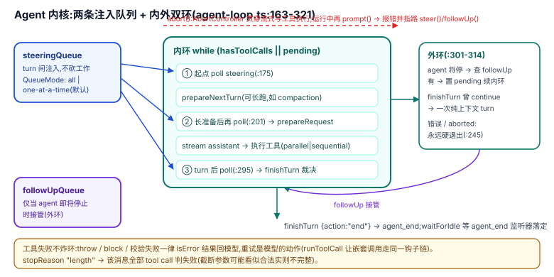

# 01 · loop 本身:双队列、内外环与钩子链

pi 编排的最小原语不是某个工具,而是 `Agent` 这个"loop 的有状态包装"暴露的三组东西:**两条注入队列**、**内外双环的节拍**,以及**环上的一排钩子**。理解了这三组,后面所有原语(扩展、subagent、durable)都是在不同平面对它们的放大。

## 为什么是这个形状:设计考量

`Agent` 的 docstring 一句话定位:"Stateful wrapper around the low-level agent loop. `Agent` owns the current transcript, emits lifecycle events, executes tools, and exposes queueing APIs for steering and follow-up messages."(`packages/agent/src/agent.ts:182-187`)。

设计上的关键取舍:**并发提示不中断、不排队等待回应,而是变成两类注入**。用户在流式输出期间打字是最常见的编排需求——砍掉当前 turn 会丢工作,干等会丢用户意图。pi 的答案是两条语义不同的队列:steer 在当前 assistant turn 的工具执行完后、下一次 LLM 调用前注入;followUp 只在 agent 即将停止时接管(`agent.ts:298-306` 的方法注释)。两条队列共用一个 `QueueMode` 开关(`"all" | "one-at-a-time"`,`types.ts:49-55`),默认 `one-at-a-time`(`agent.ts:247-248`)——一次只放最老的一条,剩下的留给下一个抽取点。**注入粒度本身是可配置的编排参数**,这在 DSH 里对应的是 inbox splice 语义,pi 把它做成了内核两级构造。

## 机制

### 内外双环

`runLoop`(`packages/agent/src/agent-loop.ts:163-321`)是两层 while:

- **内环** `while (hasMoreToolCalls || pendingMessages.length > 0)`(`:183`):处理工具调用与 steering。steering 在三个点被抽取:循环起点(`:175-176`,"user may have typed while waiting")、`prepareNextTurn` 长任务之后(`:200-206`,注释点名 "for example, compaction")、每个 turn 结束后(`:295`)。
- **外环**:agent 即将停止时查 followUp(`:301-308`),有则置为 pending 继续内环;无 followUp 但 `finishTurn` 曾决定 `continue` 时,补一次纯上下文请求(`:310-314`)。

### turn 的裁决点:finishTurn

每个完成的 turn(assistant 消息 + 全部工具结果)之后、`turn_end` 之前,宿主可给裁决:`{ action: "end" }` 直接结束 run;`{ action: "continue" }` 保证一次下一请求——工具结果、steering、followUp 都能满足它而不多发请求;错误与 abort 永远硬退出(`types.ts:146-158`,实现 `agent-loop.ts:286-294`、`:245-256`)。**"要不要再来一轮"这个编排判断被外置成一个纯回调**,DSH 的对应物是 Goal Round Driver 的轮内决策,pi 把最小版本放进内核。

### 环上的其余钩子

| 钩子 | 时机 | 能做什么 | 锚点 |
|------|------|---------|------|
| `prepareNextTurn` | 内环续轮前 | 整体替换 context/model/thinking,可附带消息(典型用途:compaction) | `types.ts:266-280`;`agent-loop.ts:185-208` |
| `prepareRequest` | 每次 LLM 请求前(含首次) | 同上,但不 poll 队列 | `types.ts:266-271`;`agent-loop.ts:219-239` |
| `beforeToolCall` | 参数校验后、执行前 | `{ block: true }` 拒绝,可带 `terminate` 参与整批早停 | `types.ts:60-74`;`agent-loop.ts:727-754` |
| `afterToolCall` | 执行后、结算前 | 逐字段覆写结果(content/details/isError/usage/terminate,无深合并) | `types.ts:76-104`;`agent-loop.ts:864-896` |

**嵌套工具调用走同一条链**:`runToolCall` 供"工具内部调用其他工具"使用,参数准备、校验、before/after 钩子全部复用——"Tools that call other tools use this so the hooks (for example permission checks) apply to those calls too"(`agent-loop.ts:801-818`)。这是权限门不被嵌套绕开的机械保证。

### 工具结算合同

- **失败不炸环**:工具 throw、未知工具、校验失败、被 block,一律变成 `isError: true` 的工具结果回到模型,循环继续(`agent-loop.ts:806-809` 的 runToolCall 合同、`:841-847` 的 catch)。
- **输出截断防呆**:`stopReason === "length"` 的消息,其全部 tool call 一律判失败——"流式参数经 best-effort JSON 修复后可能看似合法实则不完整,没有一个可以安全执行"(`agent-loop.ts:264-270`,文案 `:478-503`)。
- **并行与串行**:`toolExecution` 默认 `"parallel"`(预检串行、执行并发、结果按源顺序落账),单工具可用 `executionMode: "sequential"` 强制串行(`types.ts:39-47`、`:490-496`;实现 `agent-loop.ts:508-523`)。
- **工具集变化增量宣告**:`declareToolChanges` 把 `context.tools` 与 transcript 已宣告集合的差写进 system 消息的 `toolsAdded`/`toolsRemoved`,"replay always yields exactly `context.tools`"(`agent-loop.ts:323-363`)。
- **StreamFn 合同**:上游请求失败不得 throw,必须编码为 stopReason `error`/`aborted` 的流(`types.ts:27-37`)——失败形状在合同里就被固定成"模型可见结果",而不是异常。

### abort 与静止

`abort()`(`agent.ts:341-343`)经 AbortController 贯穿流式与工具执行;`waitForIdle()` 要等 `agent_end` 的全部已 await 监听器落定才算静止(`:256-265`、`:510-512`)——"agent_end 只表示不再有循环事件,不表示已空闲"。运行中再次 `prompt()` 直接抛错并**指路**:"Use steer() or followUp() to queue messages"(`:374-378`)——API 形状本身在教正确用法。

## 边界与上限

- 双队列是**内存态**:没有持久化、没有跨重启恢复;进程死了,队列里的消息消失(恢复语义在会话层,见 [06](./06-session-plane.md))。
- `finishTurn`/`prepareNextTurn` 是**宿主级单例**,不是可组合的中间件链;多段逻辑要自己合并(扩展系统用 `on()` 事件重新提供了多路订阅,见 [02](./02-extension-seam.md))。
- 无轮数上限、无 token 预算器:**内环是否继续由工具调用与队列决定,没有 goal-round 式的轮预算**;上下文超限的处理在 compaction 层(`core/compaction/`),不属于 loop 合同。

## 与相邻原语的关系

- 扩展系统把 `finishTurn`/工具钩子重曝成多路 `on()` 事件(`turn_end`、`tool_call` 等),让**多个扩展**同时参与节拍([02](./02-extension-seam.md));
- `AgentSession` 把 steer/followUp 包成带输入展开与 UI 队列显示的用户入口(`core/agent-session.ts:2156-2191`);
- durable 的 TaskScheduler 把"什么时候再来一轮"变成**可持久、可跨重启**的任务状态机([07](./07-durable-tasks.md))。

## 源码入口

| 路径 | 一句话 |
|------|--------|
| `packages/agent/src/agent.ts:182-187` | Agent 定位:transcript + 事件 + 工具执行 + 队列 API |
| `packages/agent/src/agent.ts:298-327` | steer/followUp/clear API;默认 one-at-a-time(`:247-248`) |
| `packages/agent/src/agent-loop.ts:163-321` | 内外双环与三个 steering 抽取点 |
| `packages/agent/src/types.ts:146-158` | finishTurn 决策合同 |
| `packages/agent/src/types.ts:60-104` | before/afterToolCall 结果合同 |
| `packages/agent/src/agent-loop.ts:801-818` | runToolCall:嵌套调用复用同一钩子链 |
| `packages/agent/src/agent-loop.ts:478-503` | 截断消息的全部 tool call 判失败 |
| `packages/agent/src/agent-loop.ts:323-363` | 工具集增量宣告,replay 即 context.tools |
