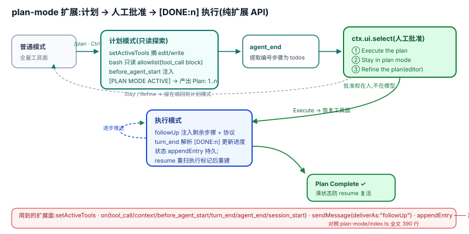

# 02 · 扩展 seam:编排能力的构造面

pi 的编排哲学在扩展系统上表现得最清楚:**内核不内置 todo、plan mode、subagent,而是提供一条足够深的口子,让它们能作为扩展被长出来。** 本页用两个官方范本(todo、plan-mode)展示这条口子的编排构造力,再列出与编排相关的 API 面。

## 为什么是这个形状:设计考量

`ExtensionAPI` 把 loop 钩子重曝成**多路事件**(`on()`),把工具面变成**可声明的活跃集合**(`getActiveTools`/`setActiveTools`,"The active tool set is the set declared to the model",`extensions/types.ts:507`),把状态变成**会话条目**(`appendEntry`,custom entry 随会话持久)。三件事合起来,一个扩展就能做编排:改工具面 = 改能力边界;注入消息 = 推进节拍;custom entry + 重放 = 跨 turn 状态。**编排原语因此不必进 core**——这正是 core-minimal 纪律([`harness/03-Discipline/3.1`](../harness/03-Discipline/3.1_core_minimal.md))能维持"8 个内置工具"的机制前提。

## 机制:API 面

| API | 作用 | 锚点(`extensions/types.ts`) |
|-----|------|------|
| `registerTool` | 注册模型可见工具 | `:1619` |
| `registerCommand` | 注册斜杠命令 | `:1628` |
| `on()` | 订阅扩展事件(工具调用、turn 生命周期、会话事件等;事件清单与机制见 [`agent/01-Anatomy/1.4`](../agent/01-Anatomy/1.4_Extension_System.md)) | `:1628` 附近 API 面 |
| `getActiveTools` / `setActiveTools` | 读/改模型可见工具集 | `:1711`、`:1723` |
| `sendMessage` / `sendUserMessage` | 以扩展身份注入消息,可选 `deliverAs`(steer/followUp)与 `triggerTurn` | `:1676`、`:1686` |
| `appendEntry` | 写 custom entry,随会话持久 | `:1692` |

## 样本一:todo —— 状态随会话树重建

`examples/extensions/todo.ts` 的头注释就是设计宣言:"State is stored in tool result details (not external files), which allows proper branching - when you branch, the todo state is automatically correct for that point in history."(`todo.ts:4-10`)。

机制:todo 列表不存文件、不存扩展闭包外的任何地方,而是存在每次工具结果的 `details` 里;状态重建 = 扫当前 branch 上的 `toolResult`(toolName 为 `todo`)取最后一条 details(`:114-129`),在 `session_start` 与 `session_tree` 两个事件上重放(`:132-133`)。

这是 pi 编排状态三分法([README](./README.md) 统一维度矩阵)的一个微型样本:**权威事实 = 会话树上的工具结果;内存态 = 重建出的列表;投影 = UI**。分支到历史某点,todo 自动"回到"那个点——编排状态获得了与会话相同的时间旅行性质,不需要任何额外持久层。

## 样本二:plan-mode —— 一套完整的"计划→批准→执行"编排

`examples/extensions/plan-mode/` 用纯扩展 API 拼出了 DSH 里由 plan-mode 包 + todo 包 + 人工审批共同承担的闭环,全部机制在 `plan-mode/index.ts` 一个文件里:

1. **进入与工具面收缩**:`/plan` 命令、`Ctrl+Alt+P`、`--plan` flag 三入口(`:53-57`、`:141-161`);启用即 `setActiveTools` 摘掉 `edit`/`write`(`:104-114`),bash 另由 `tool_call` 事件按只读 allowlist 拦截(`:164-174`)。
2. **计划注入**:`before_agent_start` 返回 `[PLAN MODE ACTIVE]` 上下文,要求模型在 "Plan:" 头下产出编号步骤(`:201-228`)。
3. **人工批准**:`agent_end` 时从最后的 assistant 消息提取步骤,弹 `ctx.ui.select` 让用户选 Execute / Stay / Refine(`:282-336`)——**批准权在人,不在模型**。
4. **执行推进**:选 Execute 后恢复工具面,把剩余步骤与 `[DONE:n]` 协议以 `deliverAs: "followUp"` 的消息交回(`:307-329`);每个 `turn_end` 解析 `[DONE:n]` 更新进度(`:250-259`)。
5. **状态跨重启**:`appendEntry("plan-mode", …)` 持久化,`session_start` 恢复;resume 后重扫最后一个 `plan-mode-execute` 标记之后的消息重建完成态(`:116-123`、`:339-389`)。

两个样本合起来回答"扩展口够不够深":**能改能力边界、能注入协议化上下文、能拦截工具调用、能把控制流交回用户、能带着状态穿越重启**——编排需要的全部手筋都在。

## 边界与上限

- 扩展事件是**观察与修改点,不是调度器**:`on("agent_end")` 里 `sendMessage({ triggerTurn: true })` 能续 turn,但"何时该续"的判断完全住在扩展自己的代码里;pi 没有 harness 级的续跑驱动。
- `deliverAs` 复用内核双队列([01](./01-loop.md)),因此继承其内存态限制:扩展进程重启后,未投递的 steer/followUp 消息不恢复(扩展状态可以恢复,排队中的注入不能)。
- 示例扩展无稳定性合同:todo/plan-mode/subagent 是 `examples/`,不是承诺 API;产品化要自己复制维护。

## 与相邻原语的关系

- plan-mode 的"执行"阶段天然可与 [03](./03-subagent.md) 的 subagent 组合(把步骤委派出去);
- `deliverAs` 的语义即 [01](./01-loop.md) 双队列;
- durable 的扩展面把同一构造力搬到持久层([07](./07-durable-tasks.md))。

## 源码入口

| 路径 | 一句话 |
|------|--------|
| `packages/coding-agent/src/core/extensions/types.ts:507,1619-1723` | 扩展 API 面:工具、命令、事件、消息注入、custom entry |
| `packages/coding-agent/examples/extensions/todo.ts:4-10,114-133` | 状态存 toolResult details,随 branch 重建 |
| `packages/coding-agent/examples/extensions/plan-mode/index.ts:104-174` | 工具面收缩与 bash allowlist |
| `packages/coding-agent/examples/extensions/plan-mode/index.ts:201-247` | 计划/执行上下文注入 |
| `packages/coding-agent/examples/extensions/plan-mode/index.ts:282-336` | 人工批准与 followUp 推进 |
| `packages/coding-agent/examples/extensions/plan-mode/index.ts:339-389` | 跨重启状态恢复 |
