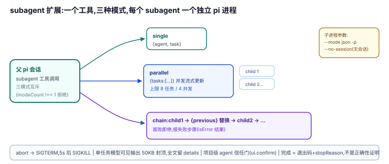

# 03 · subagent:进程级委派(示例扩展形态)

pi 没有内置委派原语;官方给出的形态是 `examples/extensions/subagent/`——一个 ~1000 行的扩展,把"把任务交出去"做成一个工具。它的每个 subagent 是一个**独立的 `pi` 进程**,这是 pi 侧上下文隔离的最高强度(内核双队列与扩展都在同一上下文,codemode 隔离的是 VM)。

## 为什么是这个形状:设计考量

README 第一句:"Delegate tasks to specialized subagents with isolated context windows… Each subagent runs in a separate `pi` process"(`examples/extensions/subagent/README.md:3,7`)。

**为什么是进程而不是进程内子 Agent**:pi 的内核没有"子 Agent"概念——`Agent` 是宿主驱动的单实例([01](./01-loop.md));要隔离上下文,最小实现就是起一个带 `-p --no-session` 的 `pi` 子进程,复用整个产品面(模型、工具、扩展加载),代价是每任务一个进程。**这是 core-minimal 的直接推论**:不为委派在 core 里造第二个 Agent 运行时,委派由产品面组合出来。

subagent 的身份定义是 markdown + YAML frontmatter(`name`/`description`/`tools`/`model`,README `:125-146`),放在 `~/.pi/agent/agents/`(用户级)或 `.pi/agents/`(项目级,默认不加载)。**"有哪些可用 subagent"是文件系统事实**,每次调用时重新发现("Agents discovered fresh on each invocation",README `:176`)。

## 机制

### 一次委派的解剖

工具层把委派翻译成子进程参数(`index.ts`):

- `["--mode", "json", "-p", "--no-session"]`(`:300`)——JSON 输出、print 模式、不留会话;
- 未指定 `model` 时继承派发会话的 model/thinking(`:301-306`;README `:140`);
- `--tools` 按 agent 定义收缩工具面(`:307`)——**警示(Unreleased,04b97ef00)**:`--tools` 不再隐式移除 MCP 工具。agent 定义若指望 `--tools` 顺带把 MCP server 挡在子代理外,现在会落空——未命中的 MCP 工具保持注册,codemode 脚本与 tool_search 仍可达;要彻底排除须显式 `--exclude-tools 'mcp__*'`,或用 `--no-mcp` 直接不加载内置 MCP 扩展;
- 自定义 system prompt 写临时文件走 `--append-system-prompt`(`:334-339`);
- `spawn` 独立进程(`:344-350`),父侧逐行解析 JSON 事件流累计 usage/turns/stopReason(`:353-395`)。

### 三种模式(互斥,必须恰好给一种)

| 模式 | 参数 | 语义 | 锚点 |
|------|------|------|------|
| single | `{ agent, task }` | 一代理一任务 | `index.ts:493-518`(modeCount !== 1 即拒绝) |
| parallel | `{ tasks: [...] }` | 并发跑多个,上限 **8 任务 / 4 并发**(`MAX_PARALLEL_TASKS`/`MAX_CONCURRENCY`,`:33-34`) | `:604-614` |
| chain | `{ chain: [...] }` | 顺序执行,`{previous}` 占位符替换上一步输出(`:556`);**首败即停**并报失败步骤(`:587-595`) | `:548-602` |

三种模式都在一个工具里,靠参数形状区分——没有 DSH 那样按模式拆成多个工具/多条 description 的做法;选择语义全部压在工具 description 与 README 里(`:475-480`)。

### 上限与输出合同

- 单任务模型可见输出截断到 **50 KB**(`PER_TASK_OUTPUT_CAP`,`:36`;截断文案带省略字节数并声明"Full output preserved in tool details",`:193-202`)——**丢给模型的与留给 UI/程序的全部细节是两个面**;
- 失败判定:退出码非 0、stopReason `error`/`aborted`(`:182-184`);失败时返回 errorMessage/stderr 供父模型诊断(`:186-191`);
- 未知 agent 名返回带可用清单的错误(`:286-298`)。

### abort 与信任门

- abort 传播:父的 signal 触发子进程 `SIGTERM`,5 秒后升级 `SIGKILL`(`:410-420`);
- 项目级 agent 是 repo 控制的 prompt,默认不加载;显式 `agentScope: "project"|"both"` 且项目未信任时,逐个弹确认(`:520-548`;README `:55-65`)——**信任边界做在委派入口**,pi 无沙箱的补位惯例([`harness/02-Boundaries/2.1`](../harness/02-Boundaries/2.1_no_sandbox.md))。

## 边界与上限(诚实登记)

1. **one-shot,无控制面**:子进程 `--no-session` 不留会话,跑完即弃;没有 DSH continuable subagent 的 send/interrupt/冷恢复,也没有 fork(继承历史)——要"继续"就重新委派。
2. **无递归预算**:扩展没有 depth 参数;子进程默认加载用户级扩展,若 subagent 也在其中,子代理可以再委派,**递归深度由用户的扩展安装范围决定,扩展本身不设防**。
3. **无结构化输出合同**:README 提"Uses JSON mode to capture structured output"(`index.ts:12` 指的是子进程 JSON 事件流),但父子之间的任务结果契约就是最后一条 assistant 文本,没有 `outputSchema` 式的强校验。
4. **完成即自报**:与 DSH ralph 同一条诚实边界——退出码 + stopReason 只证明进程正常结束,不证明任务正确。

## 与相邻原语的关系

- plan-mode 执行阶段把步骤委派给 subagent 是典型组合([02](./02-extension-seam.md)、[08](./08-choice-and-composition.md));
- codemode 提供同一"隔离执行"需求的**轻量替代**:委派对象是工具调用而不是整个 agent([04](./04-codemode.md));
- durable 把这套模式产品化成 owned conversation + replay-safe([07](./07-durable-tasks.md)),那是"真正的"持久子代理。

## 源码入口

| 路径 | 一句话 |
|------|--------|
| `examples/extensions/subagent/index.ts:300-307` | 子进程参数:json/print/no-session/model/tools |
| `examples/extensions/subagent/index.ts:344-350,410-420` | spawn 与 abort 传播 |
| `examples/extensions/subagent/index.ts:493-518` | 三模式互斥校验 |
| `examples/extensions/subagent/index.ts:548-602` | chain:{previous} 与首败即停 |
| `examples/extensions/subagent/index.ts:604-614` | parallel 上限 |
| `examples/extensions/subagent/index.ts:520-548` | 项目 agent 信任确认门 |
| `examples/extensions/subagent/README.md:91-97,172-177` | 模式表与已知限制 |
