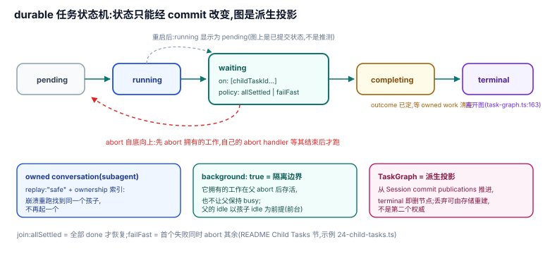

# 07 · durable tasks:实验性的持久编排层

`packages/durable` 是 pi 阶梯上唯一把**编排状态本身变成持久事实**的一级:任务、对话、工具调用全部先落存储再展示,"If the process dies mid-turn, reopening the storage picks the work up where it stopped"(`packages/durable/README.md:3-5`)。它提供 child tasks、join policy、owned conversations(subagent)与自底向上 abort——pi 版"重型编排"的完整形态,但 **experimental,API 随版本变动不另行通知**(`README.md:3`)。

## 为什么是这个形状:设计考量

普通 pi 会话([06](./06-session-plane.md))的事实层是会话树,但**编排运行态**(哪个任务在等谁、谁拥有哪个子代理、重启后从哪继续)不在事实层里——双队列是内存的,subagent 是一次性的。durable 的答案是把"运行态"压进同一条 commit 线:任务状态只能经事务提交改变,Scheduler 从已提交状态推进工作,崩溃后重启的任务从 checkpoint 恢复。**持久事实、派生投影、内存权限的边界被明确画出来**:TaskGraphView 的注释直说 "built on the Session line by its first observer… advances from the Session's commit publications, **which are durable**"(`durable/src/harness/task-graph.ts:58-62`)。

## 机制

### 任务状态机

- 活跃状态集 `pending | running | waiting | completing`,终态离开图(`task-graph.ts:19-28,55`);
- **waiting 是一等状态**:任务提交一个 `{ status: "waiting", checkpoint, on: [childTaskId…], policy }` 后不再运行任何代码,子任务就绪后由 Scheduler 恢复(`README.md` Child Tasks 节);
- **重启后的诚实投影**:"tasks that were `running` show as `pending` until they run again"——图上显示的是已提交状态,不是推测的运行态(README Task Graph 节)。

### join policy:fan-out / fan-in 的最小合同

子任务等待二选一:**`allSettled`**(全部 done 才恢复)或 **`failFast`**(首个失败同时 abort 其余)(README Child Tasks 节,官方 checkout/payments 示例 `test/examples/24-child-tasks.ts`)。fan-out 的节点由 `createTask` 循环产生,fan-in 是一次 waiting 提交——**DAG 不是数据结构,是一段顺序代码加一次状态提交**,与 codemode"脚本持有控制流"同构,只是控制流可跨重启。

### owned conversations:持久化的 subagent

subagent 工具在 `api.commit()` 里以 `ownership: { kind: "task", taskId }` 创建子 conversation,`replay: "safe"` 让崩溃重跑时经 ownership 索引**找到同一个孩子而不是再起一个**("a rerun after a crash finds the same child and submission",README Abort and Subagents 节,示例 `22/23-subagent-*.ts`)。所有权推论:

- abort 调用即 abort 孩子;调用失败(抛错或非 replay-safe 的崩溃中断)同样;
- **父的 idle 以孩子 idle 为前提**;
- `{ background: true }` 的任务是**隔离边界**:它拥有的工作在父 abort 后存活、也不让父保持 busy。

### abort 语义:自底向上

"abort runs bottom-up. Aborting a task aborts the work it owns first, and its own abort handler starts only once that work is done, so each task undoes its own effects."(README Child Tasks 节)——清理顺序由所有权图决定,补偿逻辑写在各自任务的 abort handler 里。

### TaskGraph:读时派生的投影

`harness.taskGraph()` 返回全部活跃任务的单一 Chord 状态,`watchTaskGraph()` 提供推送;节点带 owner 边、状态、background/abort 标记与拥有的 conversations(README Task Graph 节)。投影由 commit publications 增量推进(`task-graph.ts:151-190`:terminal 即删节点、conversation 归属在任务变更之后补),**图是派生视图,不是第二个权威**——被丢弃就由存储重建(`#build`,`:131-148`),这与 todo 随 branch 重建是同一条纪律的重装版。

## 边界与上限

- **experimental**:无稳定性合同(`README.md:3`);不在默认组合里,当前 pi CLI 会话不跑在 durable 上。
- **复杂度上限在包内**:join policy 只有两种;没有 DSH goal 式的"人类可编辑长目标",没有跨会话的优先级调度。
- **等待 ≠ 进度**:`waiting` 只说明提交了等待状态;子任务完成是机械条件,"完成得对不对"仍要任务代码自己验收。

## 与相邻原语的关系

- 它是 [03](./03-subagent.md) 委派模式的产品化终点(replay-safe 的子代理、可消息传递的后台孩子,示例 `23-subagent-background.ts`);
- 它把 [06](./06-session-plane.md) 的"事实先行"从会话文件升级为带事务与 watch 的存储合同;
- 与 [01](./01-loop.md) 的关系:TaskScheduler 是 loop 节拍在持久层的重写者——"什么时候跑下一步"由已提交状态决定,不再由内存队列决定。

## 源码入口

| 路径 | 一句话 |
|------|--------|
| `packages/durable/README.md:3-5` | experimental 定位与持久承诺 |
| `packages/durable/README.md`(Abort and Subagents / Child Tasks / Task Graph 三节) | owned conversation、join policy、自底向上 abort、投影语义的官方表述 |
| `packages/durable/src/harness/task-graph.ts:19-28,58-62` | 状态集与"durable commit publications"边界 |
| `packages/durable/src/harness/task-graph.ts:131-190` | 全量重建与增量推进 |
| `packages/durable/src/harness/scheduler.ts:51-54` | 活跃状态常量与长 sleep 分片 |
| `packages/durable/test/examples/22/23/24-*.ts` | 前台/后台 subagent 与 child tasks 官方示例 |
