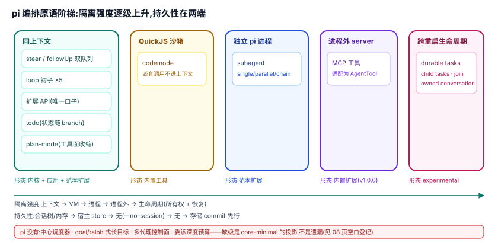

# orchestration/ — pi 的工作编排原语阶梯(驾驶座视角)

> **基线**:pi-mono `v1.0.0`(tag `a13d35a74`)。本目录全部 path:line 已在 HEAD `f0e079560` 复核,且所引用文件与 `v1.0.0` 逐字节一致(`git diff --stat a13d35a74 HEAD` 对本目录引用集为空)。
>
> 方法论备注:本目录的组织方式(原语阶梯、统一维度矩阵、选择语义盘点、诚实登记空白)借鉴 DSH `_digested/orchestration-ladder/` 的消化纪律;但**全部事实取自 pi-mono 自己的源码**,结论不预先假设 pi 与 DSH 有同构的阶梯——pi 阶梯的真实形状(缺哪些级、为什么缺)是本目录的研究发现之一,见 [README 末节](#本目录的核心发现)。

## 一句话

pi 把"工作拆解、委派、推进到完成"的几乎全部原语都放在**一个强单 agent loop + 一条深扩展口**上:内核只提供双队列注入(steer/followUp)、循环节拍钩子与工具结算合同;计划、委派、代码编排、外部工具、持久任务分别由示例扩展、内置 codemode 工具、MCP 适配和实验性 durable 层承担。**pi 没有中心调度器,也没有 goal/ralph/teams 式的原语**;阶梯的"缺级"是 core-minimal 纪律在编排面的直接投影,不是遗漏。

## 为什么存在本目录

[`agent/`](../agent/) 回答"循环怎么跑、扩展怎么挂";[`harness/`](../harness/) 回答"结构好不好"。本目录回答驾驶座的第三个问题:**pi 给了哪些把工作推进到完成的原语,各自隔离什么、上限在哪、什么时候用哪个、怎么组合。** 方法上它拥有跨原语的统一视角,机制细节引用 `agent/` 与各包 README,不重复。

## 阶梯总表

| 原语 | 位置 | 一句话语义 | 上下文隔离 | 时间跨度 | 形态 |
|------|------|-----------|-----------|---------|------|
| steer / followUp 双队列 | `packages/agent/src/agent.ts` | 运行中注入 vs 即将停止时注入 | 同上下文 | 单 run | **内核内置** |
| loop 钩子(finishTurn / prepareNextTurn / prepareRequest / before-afterToolCall) | `packages/agent/src/types.ts` | 循环节拍与工具结算的自定义点 | 同上下文 | 单 run | **内核内置** |
| 扩展 API(registerTool / setActiveTools / sendMessage / appendEntry …) | `coding-agent/src/core/extensions/types.ts` | 长出工具、命令、事件、界面与状态的唯一口子 | 同上下文 | 会话 | **应用内置** |
| todo(示例扩展) | `examples/extensions/todo.ts` | 上下文内计划留痕;状态存在 toolResult details 里,随 branch 重建 | 同上下文 | 会话 | 范本扩展 |
| plan-mode(示例扩展) | `examples/extensions/plan-mode/` | 计划先行(收缩工具面)→ 人工批准 → 执行([DONE:n] 推进) | 工具面收缩 | 会话 | 范本扩展 |
| subagent(示例扩展) | `examples/extensions/subagent/` | 每个 subagent 一个独立 `pi` 进程;single / parallel(≤8) / chain(`{previous}`) | **独立进程** | 一次性 | 范本扩展 |
| codemode(内置工具) | `packages/codemode` | 模型写 JS 在 QuickJS-WASM 沙箱里编排**工具调用**,嵌套调用不进 LLM 上下文 | 沙箱 VM | 单次执行 | 内置工具 |
| MCP 工具接入 | `packages/mcp` + coding-agent 内置扩展 | 外部工具生态适配为 `AgentTool` | 进程外 server | 按调用 | v1.0.0 采纳 |
| durable tasks | `packages/durable/src/harness/` | 持久任务图:child tasks、join policy、owned conversations、自底向上 abort | 独立 conversation | **跨重启** | experimental |

## 统一维度矩阵

| 类别 | 原语 | 执行者 | 持久事实 | 推进者 | 完成证据 |
|------|------|--------|----------|--------|----------|
| 进程内同上下文 | 双队列、loop 钩子、扩展、todo、plan-mode | 当前 Agent | 会话 JSONL 条目(含 custom entry) | 模型、用户输入、扩展事件 | turn/agent 事件;模型自报(plan 的 [DONE:n]) |
| 代码编排 | codemode | QuickJS 沙箱内脚本 | 无(沙箱内 store 由宿主保存) | 脚本控制流 | 脚本 return 值 + output |
| 进程委派 | subagent 扩展 | 独立 `pi` 进程 | 默认无(`--no-session`) | 父会话的工具调用 | 进程退出码 + stopReason |
| 外部工具 | MCP | MCP server 进程 | 无 | 模型工具调用 | `CallToolResult` |
| 持久任务 | durable | durable Harness + 存储后端 | Session commit(先落盘后展示) | TaskScheduler | task 终态 outcome;提交即持久 |

`completed`/`exitCode 0`/脚本 `return` 都不自动等于业务正确——与 DSH 同一条纪律:完成证据要分层看(见各页"边界"节)。

## 默认挂载状态

| 原语 | 默认可用? | 出处 |
|------|----------|------|
| 双队列 / loop 钩子 | 是(core) | `packages/agent/src/index.ts` |
| 扩展 API | 是(coding-agent) | `packages/coding-agent/src/core/extensions/types.ts` |
| codemode | 是(内置工具,v1.0.0 起) | `packages/codemode/README.md:5` |
| MCP | 是(内置扩展,v1.0.0 起) | `packages/mcp/README.md:3`;采纳记录见 [`harness/02-Boundaries/2.2`](../harness/02-Boundaries/2.2_no_interop_protocol.md) |
| todo / plan-mode / subagent | **否**——examples 范本,需自行 symlink 安装 | `examples/extensions/subagent/README.md:32-53` |
| durable | 否——experimental 独立包,自带 examples | `packages/durable/README.md:3` |

## 本目录的核心发现

1. **pi 的编排阶梯是"内核单级 + 扩展补级"。** DSH 的阶梯每一级都是一个有独立合同的原语包;pi 的对应能力要么在 core 里压成一条(`Agent` 的双队列),要么以示例扩展形态存在(todo/plan-mode/subagent 共 ~1700 行)——8 个内置工具 vs 70+ examples 的比例在编排面同样成立([`harness/03-Discipline/3.1`](../harness/03-Discipline/3.1_core_minimal.md) 判断二)。
2. **选择语义没有中心文本。** "什么时候用哪个"的官方语义住在各工具的 description(subagent 扩展 `index.ts:475-480`)、examples README 与 `docs/` 里;pi 没有 DSH `tool:*` prompt section 那样的策略节,也没有跨原语路由句。这是诚实登记的空白,见 [08](./08-choice-and-composition.md)。
3. **隔离强度逐级上升,持久性逐级下降再上升。** 同上下文原语(队列/扩展)不隔离上下文;codemode 隔离的是**上下文**(嵌套调用不进 LLM);subagent 隔离的是**进程**;durable 隔离的是**生命周期**(owned conversation + 跨重启)。持久性则相反:同上下文原语靠会话树,todo 随 branch 重建,subagent 默认 `--no-session` 不留痕,durable 才真正把编排状态变成持久事实。
4. **pi 没有:中心调度器、goal/ralph 式长目标原语、多代理控制面(send_message/interrupt)、深度预算。** subagent 扩展未设递归上限——子进程是否再带 subagent 取决于用户扩展目录的安装范围([03](./03-subagent.md) 边界节)。这些"没有"要么由 core-minimal 解释,要么是登记在案的开放缺口,本目录不粉饰。

## 问题登记

| 问题 | 结论页 |
|------|--------|
| 最小原语:双队列、内外环、钩子链、工具结算合同的精确形状? | [01-loop.md](./01-loop.md) |
| 扩展 API 怎么把"计划→批准→执行"这种编排长出来?两个完整样本? | [02-extension-seam.md](./02-extension-seam.md) |
| 委派原语:进程隔离、三模式、上限、abort 与信任门?缺什么? | [03-subagent.md](./03-subagent.md) |
| 代码编排:沙箱合同、上下文隔离、与 DSH workflow 的可比处与不可比处? | [04-codemode.md](./04-codemode.md) |
| 外部工具生态怎么接进来? | [05-ecosystem-tools.md](./05-ecosystem-tools.md) |
| 会话树/分支/compaction 作为编排的时间平面? | [06-session-plane.md](./06-session-plane.md) |
| durable 任务图:状态机、join policy、owned conversation、abort 语义? | [07-durable-tasks.md](./07-durable-tasks.md) |
| 选择决策、组合模式、诚实空白与收尾纪律? | [08-choice-and-composition.md](./08-choice-and-composition.md) |

## 阅读路径

先读本页建立阶梯全景,再按 [01](./01-loop.md) → [02](./02-extension-seam.md) → [03](./03-subagent.md) → [04](./04-codemode.md) → [05](./05-ecosystem-tools.md) → [06](./06-session-plane.md) → [07](./07-durable-tasks.md) → [08](./08-choice-and-composition.md) 顺序深入;只想知道"这个任务该用哪个"直接进 [08](./08-choice-and-composition.md)。

## 可审查性清单

审查或同步本目录时,每个结论页至少回答四件事:

1. **事实在哪里实现?** 页面末尾源码入口指向当前工作树的文件与行号;总览只维护跨页比较轴。
2. **失败如何暴露?** 区分 `isError` 工具结果、stopReason `error`/`aborted`、进程退出码、沙箱 `InternalError`、durable `unanswered`/task 终态——不统一写成"失败"。
3. **谁推进下一步?** 区分模型(工具调用)、用户(steer/followUp/批准)、脚本控制流(codemode/chain)、TaskScheduler(durable);扩展 `on()` 事件是观察点不是调度器。
4. **如何验证结果?** 完成证据指向可执行检查(退出码、`details`、task outcome、测试),不把模型自报当验收。
