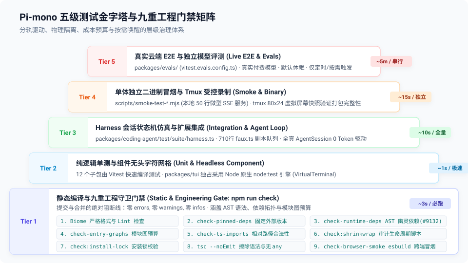

# 02 — 五级测试金字塔与执行路由矩阵

> **源码锚点**：
> - 根配置：`package.json`（scripts）、`vitest.base.ts`
> - 各包配置：`packages/*/vitest.config.ts`、`packages/tui/package.json`
> - 规范约束：`AGENTS.md`（Commands & Code Quality）

---

## 一、五级测试金字塔全景

在 `pi-mono` 中，不同类型的代码变更对应着不同层级的验证成本。整个测试体系被清晰地划分为五级金字塔：



```
                ▲
               / \
              /   \     Tier 5: 真实 E2E 与独立 Evals (按需/环境变量激活)
             / T5  \
            /───────\   Tier 4: 独立二进制冒烟与终端录制 (发布期/打包产物)
           /   T4    \
          /───────────\ Tier 3: Harness + Faux 状态机集成测试 (多轮交互/零Token)
         /     T3      \
        /───────────────\ Tier 2: 纯逻辑单测与组件网格测试 (Vitest / node:test)
       /       T2        \
      /───────────────────\ Tier 1: 静态类型与架构规则门禁 (npm run check)
     /         T1          \
    ─────────────────────────
```

---

## 二、逐级深度解剖

### Tier 1: 静态类型与九重工程守卫门禁（Static & Engineering Gate）
- **核心命令**：`npm run check`
- **执行耗时**：~3~5 秒
- **验证范围（九重自动化守卫）**：
  1. **代码规范与格式化**：`biome check --write --error-on-warnings .`，杜绝任何 warning 或格式分歧；
  2. **直接依赖强锁定**：`check-pinned-deps.mjs`，强制要求所有直接外部依赖必须固定具体版本号，严禁 `^` 或 `~`；
  3. **Monorepo 幽灵依赖防御**：`check-runtime-deps.mjs`，通过 TypeScript AST 静态扫描所有非类型 import，强行断言必须显式声明在 `package.json` 的 dependencies 中（防止被 workspace 本地软链接掩盖）；
  4. **入口模块图预算守卫**：`check-entry-graphs.mjs`，遍历各入口文件的 value-import 依赖图，限定 `maxFiles` 上限并设置黑名单，杜绝 Barrel 文件导致内存暴涨 37MB；
  5. **TypeScript 相对路径规范**：`check-ts-relative-imports.mjs`；
  6. **供应链防投毒与安装锁**：`generate-coding-agent-install-lock.mjs --check`（`check:install-lock:coding-agent`），严格审核与锁定所有含生命周期执行脚本的 npm 依赖——新增此类依赖必须显式登记 allowlist，"never add one silently"；v1.0.1 删除 npm-shrinkwrap 后，钉依赖安装与生命周期脚本审计统一由 install-lock 承接；
  7. **npm 审计显式豁免**：`scripts/npm-audit.mjs`（CI 独立 workflow `npm-audit.yml` 驱动，不在本地 `npm run check` 链内），对 `npm audit --omit=dev` 的失败不压制、只能走带理由的逐条豁免登记，已修复版本装上后条目必须移除（现存案例：node-forge）；
  8. **严格类型检查**：`tsc --noEmit`，基于 Node.js 原生 strip-only 模式，禁止使用 parameter properties、enum、namespace 等非擦除语法；全仓库严禁 `any`；
  9. **跨环境浏览器打包冒烟**：`check-browser-smoke.mjs`，通过 esbuild 模拟 `platform: "browser"` 打包，断言不漏引 Node 专属内置模块并验证 tree-shaking。
- **纪律**：任何代码提交前**必须全部清空 errors、warnings 与 infos**。

### Tier 2: 纯逻辑单测与组件网格测试（Unit & Component）
- **测试框架分轨**：
  - **核心包（packages/ai, packages/agent, packages/durable 等）**：基于 **Vitest**。验证纯函数、状态归约逻辑、类型映射；
  - **终端界面（packages/tui）**：**独占采用 Node.js 原生 `node:test` 引擎**。
- **为什么 TUI 坚决放弃 Vitest？**：
  Vitest 内部维护了复杂的 Worker 线程池和沙箱，在处理底层的终端标准输入输出（`process.stdin.setRawMode`、TTY 字符逃逸序列）时会引发严重的事件循环拦截与终端重置冲突。`packages/tui` 采用原生 `node --test`，实现毫秒级的纯字符单元与按键事件断言。

### Tier 3: Harness + Faux Provider 状态机集成测试（Integration & Agent Loop）
- **核心载体**：`packages/coding-agent/test/suite/harness.ts` 与 `packages/durable/src/harness/harness.ts`
- **执行耗时**：~10 秒（数百个复杂会话测试）
- **验证范围**：
  - 模拟真实 Agent 启动（挂载 `AgentSession`、初始化 `SessionManager`）；
  - 虚拟模型吐出 `tool_call` -> 宿主触发扩展拦截 -> 实际执行工具 -> 结果回填 -> 模型二次思考总结；
  - 覆盖工具拦截门（Tool Scope）、写文件沙箱、会话压缩（Compaction）、会话分支跳转等高难度状态跃迁。
- **铁律**：全部由 `packages/ai/src/providers/faux.ts` 驱动，**消耗 0 Token，不发一次网络请求**。

### Tier 4: 独立二进制冒烟与受控终端录制（Smoke & Binary Verification）
- **核心载体**：
  - `scripts/smoke-test-codemode-binary.mjs`：测试 QuickJS 编译后的独立二进制产物；
  - `.pi/skills/interactive-testing.md`：测试 Pi 独立打包产物（Node 与 Bun 二进制）。
- **验证手段**：
  - 本地微型 HTTP 服务吐出标准的 OpenAI 格式 SSE 协议流（Server-Sent Events）；
  - 利用 `tmux` 启动尺寸固定为 `80x24` 的虚拟终端，通过 `tmux send-keys` 注入敲键，并通过 `tmux capture-pane -p` 捕获最终屏显字符。验证打包后没有丢三落四缺少静态依赖。

### Tier 5: 真实 E2E 与独立模型评测（Live E2E & Evals）
- **核心载体**：
  - `packages/ai/test/*-e2e.test.ts` 与 `packages/agent/test/e2e.test.ts`：真实云端 API 全链路测试（如思维链绑定、缓存亲和性验证）；
  - `packages/evals/`：模型编程能力基准打分。
- **触发机制**：
  - **默认休眠**：日常 `test.sh` 绝对不执行这一层；
  - **环境嗅探激活**：只有当环境中显式传入 `ANTHROPIC_API_KEY` 等真实凭据时，这部分测试才会选择性唤醒；
  - **独立运行器**：Evals 拥有专用的 `vitest-evals` 命令行工具与配置文件（`vitest.evals.config.ts`），与常规单元测试彻底物理分流。

---

## 三、开发者与 AI 的执行路由表

在日常研发中，Coding Agent 必须严格根据下表路由测试命令，严禁盲目执行高危脚本：

| 变更类型 | 允许执行的测试命令 | 严格禁止的行为 |
|---|---|---|
| **修改了任何 TS 代码** | `npm run check`（全量类型检查，无截断输出） | 禁止在未修完类型前运行测试 |
| **全量常规回归测试** | `./test.sh`（从根目录运行沙箱回归） | **严禁直接跑 `vitest` 全量套件**（会误触发 E2E） |
| **调试单个 Vitest 测试** | `node "$(git rev-parse --show-toplevel)/node_modules/vitest/dist/cli.js" --run test/specific.test.ts` | 严禁使用全局 vitest 命令 |
| **调试 TUI 相关单测** | `node --test test/specific.test.ts`（在 `packages/tui` 目录下） | 严禁在 `packages/tui` 下运行 vitest |
| **发布包与产物冒烟** | 参照 `.pi/skills/interactive-testing.md` 启动 tmux 验证 | 严禁仅靠终端启动成功就判断发布绿灯 |

---

## 四、架构启示

1. **分轨让速度与安全兼得**：
   静态门禁 3 秒、单测 1 秒、Harness 状态机 10 秒。通过严格的分轨路由，Coding Agent 可以在极低延迟下完成高频自愈闭环。
2. **测试引擎根据物理特性选型**：
   不盲从单一框架——核心业务选 Vitest 获取模块化与热重载优势；底层终端选 `node:test` 保护原生 I/O 管道；打包冒烟选 `tmux` 还原最真实的操作系统终端环境。
