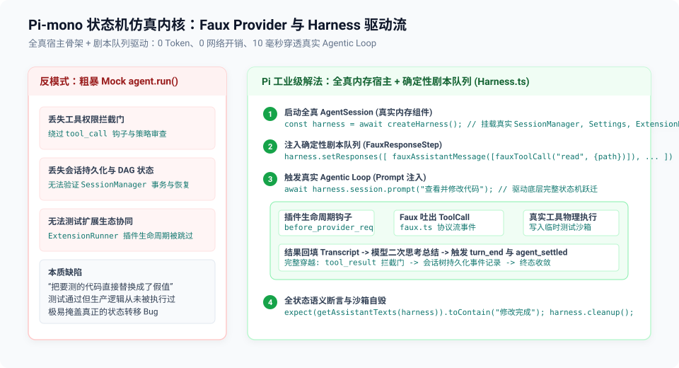

# 03 — 虚拟模型驱动内核与 Agent 会话测试：faux.ts 与 harness.ts 深度解密

> **源码锚点**：
> - 官方 Faux Provider 内核：`packages/ai/src/providers/faux.ts`（727 行；v1.0.3 时为 711）
> - Agent 会话集成测试套件驱动：`packages/coding-agent/test/suite/harness.ts`（278 行，v1.4.0）
> - 核心驱动范例：`packages/coding-agent/test/test-harness.test.ts`

---

## 一、核心挑战：如何不靠大模型测试 Agentic Loop？

AI Agent 软件的核心复杂度不在于单次调用大模型，而在于**多轮状态机循环（Agentic Loop）**：
`接收指令 -> 组装上下文 -> 模型决策 -> 触发插件拦截 -> 物理执行工具 -> 结果格式化 -> 塞回上下文 -> 二次思考 -> 结束或重试`。

如果调用真实大模型：测试极其缓慢、偶发 Flaky、浪费巨额 Token。
如果是粗暴地使用 `vi.fn()` 把 `agent.run()` 这一层整个 Mock 掉：测试虽然快，但**根本没有测到真实的 Agent 循环逻辑**（中间的钩子、权限门、会话持久化和状态机全被绕过了）。

Pi-mono 给出了一套工业级解法：**全真宿主骨架 + 确定性虚拟模型内核（Faux Provider）+ 内存会话线缆（Harness）**。

---

## 二、解密 packages/ai/src/providers/faux.ts：727 行的虚拟模型引擎

`packages/ai/src/providers/faux.ts` 不是玩具级的静态桩，而是一个在数据结构和协议上完全遵循 `Provider` 接口的完整微内核。

### 1. 结构化构建块辅助函数（Atomic Builders）
为了让测试用例能够像搭积木一样声明模型的预期反应，`faux.ts` 暴露了一组纯函数：
```typescript
// 构造思考块 (Thinking Content)
export function fauxThinking(thinking: string): ThinkingContent {
  return { type: "thinking", thinking };
}

// 构造工具调用块 (Tool Call)
export function fauxToolCall(name: string, arguments_: ToolCall["arguments"], options = {}): ToolCall {
  return {
    type: "toolCall",
    id: options.id ?? randomId("tool"),
    name,
    arguments: arguments_,
  };
}

// 构造完整的 Assistant 消息
export function fauxAssistantMessage(
  content: string | FauxContentBlock | FauxContentBlock[],
  options: { stopReason?: AssistantMessage["stopReason"]; ... } = {}
): AssistantMessage {
  return {
    role: "assistant",
    content: normalizeFauxAssistantContent(content),
    api: "faux",
    provider: "faux",
    model: "faux-1",
    usage: DEFAULT_USAGE,
    stopReason: options.stopReason ?? "stop",
    timestamp: options.timestamp ?? Date.now(),
  };
}
```

### 2. 剧本队列与动态工厂（FauxResponseStep & Factory）
模型在每一轮的反应不仅可以是静态的数据块，还可以是一个动态工厂函数：
```typescript
export type FauxResponseFactory = (
  context: TranscriptContext,
  options: SimpleStreamOptions | undefined,
  state: FauxProviderState,
  model: Model<string>,
) => AssistantMessage | Promise<AssistantMessage>;

export type FauxResponseStep = AssistantMessage | FauxResponseFactory;
```
这意味着在复杂的集成测试中，虚拟模型可以**“阅读”宿主刚刚传过来的真实上下文（`TranscriptContext`）**，并根据上一步工具执行的输出内容，动态决定下一步是继续调用工具还是输出最终回复！

---

## 三、解密 packages/coding-agent/test/suite/harness.ts：Agent 循环线缆

有了虚拟模型内核，`harness.ts` 将其无缝缝合进 Pi 的核心应用层（`AgentSession`）。



```
[Harness 测试用例]
       │
       ├── 1. 创建全真内存组件:
       │      ├── SessionManager (管理内存对话树)
       │      ├── SettingsManager (内存配置注册表)
       │      └── ExtensionRunner (真实的插件生命周期分发器)
       │
       ├── 2. 注入 Faux Provider 剧本队列:
       │      registerFauxProvider({ responses: [step1, step2] })
       │
       ▼
[AgentSession.prompt("帮我修改代码")]
       │
       ▼ 触发全真 Agent Loop
[Pi 循环分发]
       ├─► 触发 extension.on("turn_start")
       ├─► 组装 buildSystemPrompt()
       ├─► 触发 extension.on("context")
       ├─► 向 Faux Provider 请求流式输出
       │     └─► Faux Provider 吐出 step1: fauxToolCall("edit", { path: "a.ts" })
       ├─► 触发 extension.on("tool_call") 拦截门
       ├─► 执行真实工具 (写入临时测试文件)
       ├─► 触发 extension.on("tool_result")
       ├─► 再次调用 Faux Provider
       │     └─► Faux Provider 吐出 step2: fauxAssistantMessage("修改完成")
       └─► 触发 extension.on("turn_end") 与 agent_settled
```

### 真实测试用例的书写体验
来看一个典型的 Harness 测试实战代码（选自 `test/test-harness.test.ts`）：

```typescript
// 典型用法（基于 packages/coding-agent/test/suite/harness.ts）
test("harness runs multi-turn tool calling deterministically", async () => {
  const harness = await createHarness();
  
  // 注入两轮剧本
  harness.setResponses([
    // 第 1 轮：模型决定调用 read 工具
    fauxAssistantMessage([fauxToolCall("read", { path: "test.txt" })], { stopReason: "toolUse" }),
    // 第 2 轮：模型根据读到的内容给出总结
    fauxAssistantMessage("文件内容已确认，测试通过。"),
  ]);

  // 在测试沙箱中写入夹具文件
  writeFileSync(join(harness.tempDir, "test.txt"), "hello pi");

  // 发起指令，驱动全真循环
  await harness.session.prompt("查看 test.txt 的内容");

  // 断言宿主和插件的状态流
  expect(getAssistantTexts(harness)).toContain("文件内容已确认，测试通过。");
  expect(harness.session.messages.length).toBe(4); // user, assistant(call), toolResult, assistant(summary)
  
  harness.cleanup();
});
```

---

## 四、为什么这套架构是面向 AI 时代测试的典范？

1. **零代码妥协（Zero Production Compromise）**：
   生产代码（`AgentSession`、`ExtensionRunner`）不需要为了测试而到处插满 `if (isTesting)` 的丑陋判断。生产代码看到的就是一个标准的 `Provider` 实例。
2. **纳秒级确定性执行**：
   一个包含 5 轮多代理交互、2 次工具调用拦截和 1 次会话分支压缩的复杂测试，在 Harness 下执行**只需不到 15 毫秒**。
3. **Coding Agent 的自愈调试天堂**：
   当负责维护仓库的 Coding Agent 重构了工具注册逻辑时，它只需运行该测试，毫秒级即可获知参数格式、钩子触发顺序是否被破坏，彻底摆脱外部网络的干扰。
