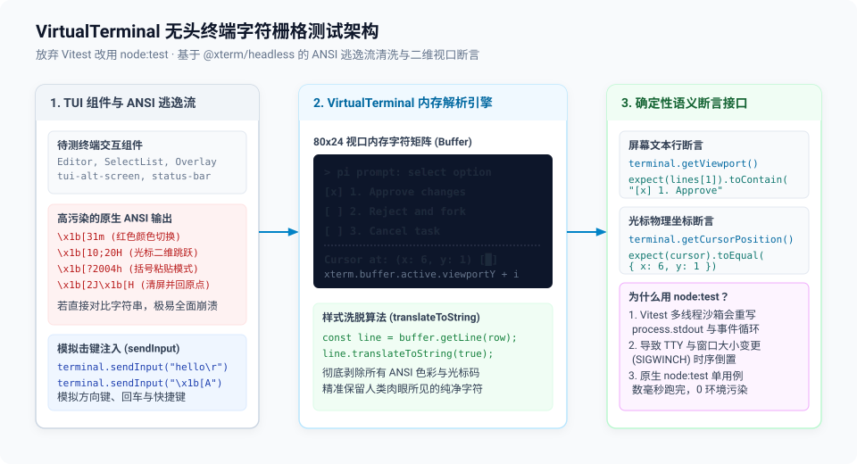

# 04 — TUI 无头测试与 Node:test 实践：VirtualTerminal 与字符网格断言

> **源码锚点**：
> - 测试入口与运行器：`packages/tui/package.json`（`"test": "node --test --test-reporter=dot --test-reporter-destination=stdout test/*.test.ts"`（v1.4.0 起））
> - 虚拟终端核心实现：`packages/tui/test/virtual-terminal.ts`（219 行）
> - 复杂交互用例：`packages/tui/test/editor.test.ts`、`packages/tui/test/tui-alt-screen.test.ts`

---

## 一、核心痛点：为什么 TUI 测试是自动化测试的噩梦？

终端交互应用（TUI）的自动化测试在整个软件工程中向来以“难写、易挂、极其脆弱”著称：
1. **ANSI 逃逸码污染**：终端中渲染一段红色文本，底层输出的是 `\x1b[31mHello\x1b[0m`。若直接做字符串对比，任何颜色样式或光标移动的微小重构都会让所有断言全军覆没；
2. **光标位置与屏幕重绘时序**：终端渲染依赖光标跳跃（`\x1b[10;20H`）和增量差异更新（Differential Rendering）。如果测试环境没有真实的屏幕缓冲，根本无法断言某个组件最终显示在第几行第几列；
3. **CJK 宽字符与多字节表情切分**：中文、日文字符占用两个终端单字符单元（Columns），Emoji 更是可能占用组合码。在行尾截断时极易出现乱码或边框错位；
4. **TTY 原始模式污染**：测试运行中若强行调用 `process.stdin.setRawMode(true)`，一旦测试异常崩溃，开发者的控制台就会被彻底锁死甚至无法接收回车。

---

## 二、架构决策：为什么坚决弃用 Vitest、改用 node:test？

在 `pi-mono` 的根配置中，几乎所有包都使用 Vitest，唯独 `packages/tui` 严格声明只用 Node.js 内置的 `node:test`：

```bash
# 规范命令（在 packages/tui 目录下）:
node --test test/specific.test.ts
```

### 底层深度原因
- **Vitest 的多线程沙箱反噬**：Vitest 默认在 Worker 线程或 Vite 转换器中运行，拦截并重写了底层的 `process.stdout` 和事件循环。当测试涉及 TTY 探测、窗口大小重置（`SIGWINCH`）时，Vitest 的虚拟层会导致真实的流事件被截断或时序颠倒；
- **零外部依赖与极致精简**：Node 原生 `node:test` 不注入任何全局变量，保持 Node.js 进程环境的绝对原生纯净；执行开销极低，单个组件测试在数毫秒内完成。

---

## 三、解密 VirtualTerminal：基于 @xterm/headless 的无头终端

为了在没有物理显示器的环境下准确测试终端渲染结果，`packages/tui` 构建了 `VirtualTerminal`（基于 `@xterm/headless`）：



```
[TUI 组件: Editor / SelectList / Overlay]
       │
       ▼ 输出原生 ANSI 转义序列 (\x1b[?2004h, \x1b[2J, ...)
[VirtualTerminal (80x24 虚拟网格)]
       │
       ├─► 1. xterm 内存解析引擎: 将 ANSI 序列精确映射到二维字符矩阵
       │
       ├─► 2. 模拟输入 (sendInput): 向组件注入键盘击键与括号粘贴流
       │
       ├─► 3. 模拟重绘与缩放 (resize): 动态调整 columns/rows 并触发 onResize
       │
       ▼
[测试断言: getViewport() / getCursorPosition()]
       └─► 提取纯净字符文本进行语义断言 (彻底剥离 ANSI 杂质)
```

### 1. 纯净字符矩阵提取（getViewport 与 flushAndGetViewport）
`VirtualTerminal` 内部维护了由 xterm 引擎驱动的二维字符网格。测试无需关心中间发射了多少次光标移动，只需断言**屏幕上第 N 行的最终显示文本**：

```typescript
// 选自 packages/tui/test/virtual-terminal.ts
getViewport(): string[] {
  const lines: string[] = [];
  const buffer = this.xterm.buffer.active;

  // Get only the visible lines (viewport)
  for (let i = 0; i < this.xterm.rows; i++) {
    const line = buffer.getLine(buffer.viewportY + i);
    if (line) {
      lines.push(line.translateToString(true));
    } else {
      lines.push("");
    }
  }

  return lines;
}
```
通过 `line.translateToString(true)`，所有样式逃逸码被彻底洗脱，只留下人类肉眼在终端该行看到的一模一样的纯净字符串。

### 2. 交互仿真与击键注入
测试可以向虚拟终端精确注入任何按键组合：
```typescript
terminal.sendInput("hello world\r"); // 模拟敲入文本并按回车
terminal.sendInput("\x1b[A");       // 模拟按下上方向键 (Up Arrow)
```

---

## 四、硬核回归测试矩阵

在 `packages/tui/test/` 目录下，包含大量专门针对终端极端边界场景的回归测试用例：

1. **CJK 与表情符号边界回归（`regression-overlay-cjk-boundary.test.ts`）**：
   专门测试当对话历史包含中文字符、中英混排时，右上角浮动弹出的 Overlay 遮罩层是否会出现行宽计算偏差导致的边框破裂；
2. **Alt-Screen 全屏缓冲切换（`tui-alt-screen.test.ts`）**：
   Pi v1.0.0 默认开启 fullscreen 模式。测试断言进入交互时是否正确发送 `\x1b[?1049h` 切换到备用屏幕缓冲区，并在进程退出或抛异常时恢复主屏幕。**v1.4.0 修正了口径**：此前不调 `stop()` 的退出路径（如直接 `process.exit()`）并不恢复；v1.4.0 加了 `process.on("exit")` 兜底（`src/tui.ts:949-952,575-590`），硬杀与原生崩溃仍不覆盖。
3. **大数据量流式吞吐压力测试（`alt-screen-large-transcript-bench.ts`）**：
   断言当模型流式吐出上万行代码时，虚拟视口滚动计算（Viewport Scroll Churn）的 CPU 与内存占用是否保持恒定；
4. **退出兜底（`exit-restore.test.ts` + `test/fixtures/exit-without-stop.ts`，v1.4.0 新增）**：
   子进程不调 `stop()` 直接退出，断言 stdout 里仍有 bracketed paste 关闭、Kitty keyboard pop、SGR reset 等恢复序列；
5. **Markdown 边界（`markdown.test.ts`，v1.4.0 扩）**：未闭合 `$$` 不再吞 GFM 表格；CJK 标点旁的粗/斜体用 `marked-cjk-friendly` 渲染；
6. **补全查询（`autocomplete.test.ts`，v1.4.0 扩）**：含 `[`/`(` 等正则元字符的查询不再返回空——修的是 fd 正则转义，模糊匹配本身未变；
7. **终端图像（`terminal-image.test.ts`，v1.4.0 扩）**：Rex（`TERM_PROGRAM=rex`）走 Kitty images + truecolor + OSC 8；
8. **按键路由测试矩阵（`tui-alt-screen.test.ts:901` 起，v1.0.3 键位修复 #10314 的配套回归）**：
   同一个逻辑按键在不同终端里是不同的字节序列。该用例向虚拟终端注入一整组 Home/End 逃逸序列（`\x1bOH`、`\x1b[F`、`\x1b[57423u` 等），断言**全部**路由给聚焦组件（编辑器）——"unmodified Home/End belong to the editor in every UI mode"；再注入 `\x1b[1;5H`/`\x1b[1;5F`（Ctrl+Home/End），断言其路由给 transcript 滚动（跳顶/跳底）。这是"最终状态断言"方法论在**输入侧**的镜像：不关心终端发了什么字节序列，只断言路由结果——多终端兼容问题被压缩成一张可穷举的序列表。

---

## 五、对 Agent 与扩展开发者的启示

1. **测试视图的“最终状态”，而非“中间序列”**：
   不要去断言 ANSI 流的具体字符，通过无头终端提取栅格化后的文本行进行断言，能使 UI 测试拥有极强的抗重构韧性；
2. **选择适合协议特性的测试运行器**：
   当业务涉及底层系统调用、管道或 TTY 时，毫不犹豫地选择平台原生工具（`node:test`），避免被复杂的第三方单测框架“智能特性”反噬。
