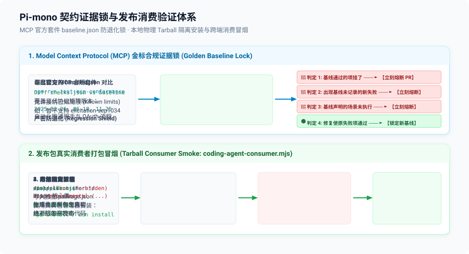

# 09 — 协议合规证据锁与工程守卫：MCP Conformance、幽灵依赖防御与打包消费验证

> **源码锚点**：
> - 协议合规基线测试：`packages/coding-agent/test/mcp-conformance/`（`run.ts`、`baseline.json`）
> - CI 工作流配置：`.github/workflows/ci.yml`（`mcp-conformance` 独立 Job）
> - 幽灵依赖防御脚本：`scripts/check-runtime-deps.mjs`、`scripts/check-runtime-deps.test.mjs`
> - 入口模块图预算守卫：`scripts/check-entry-graphs.mjs`
> - 消费者真实打包冒烟：`scripts/coding-agent-consumer.mjs`、`scripts/coding-agent-consumer.test.mjs`
> - 跨平台同构打包冒烟：`scripts/check-browser-smoke.mjs`
> - 跨后端等价性测试套件：`packages/durable/src/testing/storage-conformance.ts`（1584 行）

---

## 一、为什么“测试通过”不等于“工程可用”？

在许多开源 Agent 项目中，最常见的灾难不是单测没跑通，而是以下几种**“单测全绿，发布即崩溃”**的隐蔽故障：
1. **幽灵依赖泄漏（Ghost Dependency Leakage）**：在 Monorepo 中，子包 A 引用了子包 B 的代码，但没有在 `package.json` 中声明 `dependencies`。因为本地开发存在 Workspace 软链接，本地单测 100% 正常；一旦发布到 npm，用户安装后立即抛出 `Cannot find package` 暴毙；
2. **Barrel 文件内存暴涨（Module Graph Explosion）**：某个窄入口随手写了一个 `export *`，由于引入了 Barrel 文件，用户仅仅 import 了一个几行的小函数，Node 却在内存中加载求值了整整 37MB 的模块图；
3. **发布包黑盒缺陷（Packaging Amnesia）**：打包脚本漏了某个必须的发布文件，或者把开发期的敏感调试路径打包了进去；
4. **外部协议退化（Protocol Drift）**：遵循 Model Context Protocol (MCP) 等外部开放标准时，本地修了一个 Bug，却不小心破坏了协议握手时序。

Pi-mono 在代码库内建立了一套被称为**“工程守卫与契约证据锁（Supply-Chain Guards & Contract Evidence Locks）”**的深层防御网。

---

## 二、MCP Conformance：金标基线锁（Golden Baseline Locking）

Pi 内置了对 Model Context Protocol (MCP) 的客户端支持。为了确保 Pi 对 MCP 协议的实现与官方规范保持绝对一致，Pi 在 `packages/coding-agent/test/mcp-conformance/` 引入了**基线锁机制**。

### 1. 运行官方合规套件
在 CI 中，专门开辟了独立的 `mcp-conformance` Job（见 `.github/workflows/ci.yml`）：
```bash
npm run test:mcp-conformance
```
它利用 `npx` 调度官方锁定的合规测试套件（`@modelcontextprotocol/conformance@0.2.0-alpha.11`），针对 Pi 所支持的每一个协议版本（`2025-03-26`、`2025-06-18`、`2025-11-25`）逐一启动场景服务器，并运行 Pi 的真实 MCP 客户端通信逻辑。

### 2. baseline.json 证据锁的硬核拦截逻辑
官方套件可能包含一些 Pi 本身设计上不实现、或者当前版本尚在迭代中的特性。Pi 没有选择“跳过这些测试”，而是将全量测试输出固化进版本控制的 [`baseline.json`](file:///Users/bowhead/pi-mono/packages/coding-agent/test/mcp-conformance/baseline.json)：



```
[运行 MCP 官方测试]
        │
        ▼ 捕获所有场景执行结果 (Checks)
   与 baseline.json 进行深度 Diff
        │
        ├─► 场景 1: 基线原本通过的检查，现在挂了 ──► 【立即判为失败 (Regression Block)】
        ├─► 场景 2: 出现了一个未被基线记录的未知失败 ──► 【立即判为失败 (Unexpected Failure)】
        ├─► 场景 3: 基线原本标记的场景没有执行 ──► 【立即判为失败 (Missing Scenario)】
        └─► 场景 4: 原本失败的检查现在开始通过了 ──► 【通过并提醒开发者更新 baseline.json 锁定战果】
```

这种机制被称为**“契约证据锁”**：它允许系统在演进中接纳已知局限，但**对任何未预期的回归保持零容忍**；一旦某个功能被修复，必须显式提交 `baseline.json` 的更新，将其锁定为不可逆转的新基线。

---

## 三、Monorepo 供应链守卫：AST 幽灵依赖与模块图预算

在静态门禁 `npm run check` 的底层，运行着一组基于 TypeScript AST 的工程审计脚本。

### 1. 静态 AST 审计幽灵依赖（`scripts/check-runtime-deps.mjs`）
针对历史 Issue `#9132`（工作区解析与全量安装掩盖了缺失的运行时依赖），该脚本利用 TypeScript 编译器 API 遍历所有子包源码：

```typescript
// 静态解析 AST 提取所有非类型引用
function visit(node) {
  if (isImportDeclaration(node)) {
    // 排除类型擦除引用 (import type / element.isTypeOnly)
    if (clause.phaseModifier !== SyntaxKind.TypeKeyword && ...) {
      checkSpecifier(node.moduleSpecifier);
    }
  }
}
```

- **类型擦除豁免**：如果是 `import type { Foo }`，编译后会被完全擦除，不占用运行时依赖，合法放行；
- **值引用强制声明**：如果是运行时真实值引用（Value Import），脚本强行核对当前包 `package.json` 中的 `dependencies`。如果发现未声明的外部包或工作区包，即便当前 Monorepo 软链接能找到，也**直接判定失败并阻断提交**。

### 2. 入口模块图预算门禁（`scripts/check-entry-graphs.mjs`）
文档头有一句极具工程洞察力的宣言：
> *"Entry points are cost contracts. ... importing a 1-file pure function through a barrel costs ~37 MB of evaluated module graph, and nothing fails until someone measures a process."*

为了防止无意识的 `export *` 将整个巨石依赖拖入轻量入口，该脚本对各个核心导出子路径设立了**物理图预算（Module Budgets）**：

```javascript
const BUDGETS = {
  "packages/ai": {
    "./models": {
      maxFiles: 15,
      forbid: ["providers/", "models.generated.ts", "index.ts", "utils/validation.ts"],
    },
    "./utils/*": { maxFiles: 3, forbid: ["providers/", "api/", "index.ts"] },
  },
  "packages/durable": {
    ".": { maxFiles: 60, forbid: ["packages/ai/src/index.ts"] },
  },
};
```
当开发者引入了一个新的模块依赖，使得 `./models` 遍历到的文件数突破了 15 个上限，或者触碰了 `providers/` 黑名单，门禁立即熔断，强制开发者重构解耦。

---

## 四、真实消费者打包冒烟（Consumer Smoke Testing）

普通的单测只是在源文件树（TS 源码）上运行。为了杜绝“发包后用户用不了”，Pi 编写了 `scripts/coding-agent-consumer.mjs`：

1. **真实物理打包**：调用 `npm pack --ignore-scripts`，将所有公开发布的包真实打包为 `.tgz` 压缩归档；
2. **宿主隔离沙箱**：在系统的 `/tmp` 目录下创建一个全新的空目录作为外部消费者工程，写入一个使用 `file:./tarballs/...` 的真实 `package.json`；
3. **真实包管理器安装**：分别调用 `npm install --omit=dev` 与 `bun install --production` 执行物理安装；
4. **包内脏资产审查**：
   ```javascript
   for (const path of ["dist/client", "dist/experimental", "dist/bundle/client.js"]) {
     if (existsSync(join(packageDir, path))) {
       throw new Error(`Published package contains development-only code: ${path}`);
     }
   }
   ```
   严格断言发布的 tarball 中**绝不能残留任何开发期/实验性模块**；
5. **消费端 SDK 与 CLI 校验**：以纯外部第三方的视角执行一段 `smoke-sdk.mjs`，验证能否成功导入 `{ createAgentSession, SessionManager, ModelRuntime }`，并执行编译后的 CLI 二进制（`pi --version`），断言其输出与版本号完全吻合。

---

## 五、跨后端等价性测试套件（Storage Conformance Suite）

在 `packages/durable/src/testing/storage-conformance.ts` 中，Pi 沉淀了一套长达 **1584 行** 的通用存储规范测试集。

### 为什么需要统一 Conformance Suite？
`packages/durable` 同时支持三种存储后端：
- `sqlite-storage`（生产默认，支持 ACID 事务与磁盘恢复）；
- `jsonl-storage`（纯文本流追加，便于调试与审计）；
- `memory-storage`（纯内存，用于高速单测）。

如果分别为三个后端编写各自的测试，很容易出现“SQLite 支持某种复合查询边界，而 JSONL 行为略有偏差”的隐蔽缺陷。

### 参数化断言架构
Pi 的解法是将全量的状态机行为抽象为参数化的 `runStorageConformanceTests(factory)`：
1. **统一生命周期**：测试套件统一覆盖根会话创建、多分支分叉、任务拓扑挂载、游标回放、快照压缩与脏读防御；
2. **多包复用**：`test/sqlite-storage.test.ts`、`test/jsonl-storage.test.ts` 与 `test/memory-storage.test.ts` 仅仅负责提供各自的数据库实例工厂，随后直接挂入这套 1584 行的断言套件；
3. **行为完全等价**：保证任何第三方或者未来新增的存储驱动，只要能跑通这套 Conformance Suite，就能 100% 无缝替换生产环境的底层存储。

---

## 六、Issue 驱动的复盘测试文化（Issue-Referenced Regression Culture）

在 `pi-mono` 的全代码库与 `AGENTS.md` 规范中，确立了一条雷打不动的纪律：
> *"When regressions tests for fixing a github issue, add a comment with the github issue number next to the test."*

在整个代码库的测试文件中，随处可见精准关联 Issue 的用例注释：
- `// Regression test for #9099: released clients before 0.85.0 cannot use the mixed-API catalog.`
- `// #9132: workspace resolution and installing every release package masked a missing runtime dependency.`
- `// Regression test for #8841: alt-screen restore on uncaughtException.`

### 架构价值
1. **测试用例即“可执行的事故复盘报告（Executable Postmortems）”**：代码可能经过多次重构，但只要带着 Issue 编号，任何开发者或 Coding Agent 在阅读测试时，都能瞬间定位到当年的故障现场与真实上下文；
2. **防止“善意重构引发经典复发”**：未来如果有人试图删除一段看似多余的防御代码，当他看到绑定的 Issue 测试报错时，就能立刻理解那段代码背后的血泪教训。

---

## 七、总结：高质量 Agent 工程测试的终极全景

从 `01` 到 `09`，Pi-mono 的测试哲学可以高度凝练为四大支柱：

| 支柱维度 | 核心代表 | 解决的本质工程问题 |
|---|---|---|
| **物理环境真空** | `test.sh`（`env -i`、`.pi-test-owned`） | 消除宿主配置泄漏与磁盘脏残留 |
| **全真状态机仿真** | `faux.ts`（710 行）+ `harness.ts` | 0 Token、毫秒级驱动 Agentic Loop 闭环 |
| **发布与供应链守卫** | `check-runtime-deps` + `coding-agent-consumer` | 消除 Monorepo 幽灵依赖与发包不可用 |
| **标准契约证据锁** | MCP `baseline.json` + `storage-conformance.ts` | 跨外部协议、跨后端存储的长周期防退化 |
