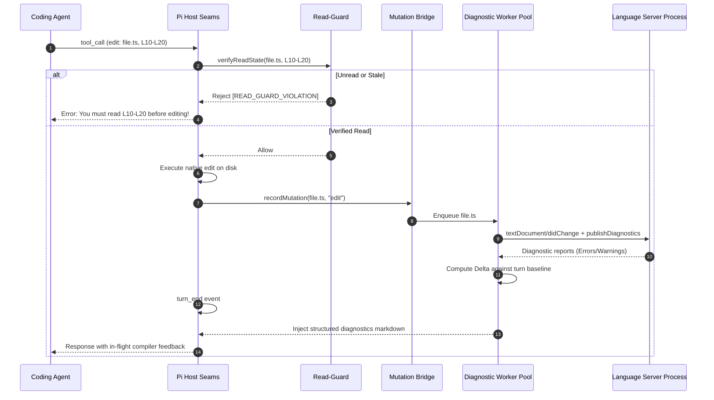

# 深度案例 06: pi-lens —— 极致语言智能与运行时诊断伴侣 (In-Flight Compiler & Diagnostics Companion)

> **定位**: 顶级生态霸主 / 语言语义反馈基础设施 (Monthly Installs: 75K+)  
> **包名**: `pi-lens` (作者: Apostolos Mantzaris)  
> **源码坐标**: `~/.pi/agent/npm/node_modules/pi-lens/`  
> **核心标签**: LSP 桥接、Tree-Sitter WASM、ast-grep 结构化重构、Read-Guard 防御性编辑屏障、跨插件 Mutation Bridge

---

## 1. 前后他要做什么 (Before & After Intent / Problem & Solution)

### Before (没有 pi-lens 时的盲目摸黑)
在纯原生的大模型编程代理环境中，Agent 往往处于「半盲目（Semantic-Blind）」状态：
1. **语法与类型幻觉蔓延**: Agent 调用 `edit` 或 `write` 修改 TypeScript、Python 或 Rust 代码后，只有在显式运行冗长的编译命令（如 `npm run build`、`cargo check`）时才能发现类型错误或破坏性改动。如果上下文紧张，Agent 往往跳过编译，留下难以察觉的类型断裂。
2. **全局上下文滥读 (Context Flooding)**: 为了修改一个类中的某个方法，Agent 经常被迫读取整个几千行的文件（耗尽大量 Token，降低注意力精准度）。
3. **编辑破坏与冲突 (Edit Clashing)**: Agent 在没有仔细阅读目标函数上下文的情况下凭幻觉瞎猜缩进、行号或局部变量，导致替换失败或引入静默 Bug。
4. **无法感知的涟漪效应 (Ripple Effects)**: 修改了 `A.ts` 的接口类型定义，完全不知道已导致下游引用方 `B.ts` 和 `C.ts` 产生类型错误，直到最终集成测试挂掉。

### After (引入 pi-lens 后的语义闭环驾驶舱)
`pi-lens` 在 Agent 的每一次击键和写入之间建立了一个**低延迟、分层的运行时诊断与语义智能网络**：
1. **零延迟编译级反馈 (In-Flight Diagnostics)**: 每次工具调用写入后，自动触发增量 LSP 探测和静态分析（Biome, Ruff, ast-grep, oxfmt），在 `turn_end` 甚至 `tool_result` 粒度将诊断注入给 Agent。
2. **精准探索漏斗 (Discovery Funnel)**: 提供 `symbol_search` -> `module_report` -> `read_symbol` / `read_enclosing`，让 Agent 无需读取整个文件即可获取精准符号签名与封闭作用域，节省 80% 以上的代码阅读 Token。
3. **Read-Guard 防御性屏障**: 强行校验「Agent 在编辑该行/符号前，是否真正阅读过对应内容」。若未读则拦截非法编辑，彻底消灭幻觉补丁。
4. **影响级联 (Impact Cascade)**: 当文件 `A` 被修改，自动分析下游依赖图，对受波及的 `B`、`C` 文件执行静默 LSP 探测，提前预警涟漪断裂。
5. **跨插件突变桥 (Inter-Extension Mutation Bridge)**: 挂载全局符号 `globalThis[Symbol.for("pi-lens:mutation-bridge")]`，让第三方插件生成的代码写入也能纳入诊断流。

---

## 2. 影响面是什么 (Impact & Blast Radius)

`pi-lens` 是一个极具侵入性且控制力极强的深度扩展，其影响面涵盖执行周期、Token 预算、文件系统与安全性：

```
[Agent Turn] 
     │
     ├── 1. Read-Guard Inspection ── (Block unread edits before FS execution)
     ├── 2. Native Tool Execution ── (Writes disk)
     ├── 3. Mutation Bridge Track ── (Records dirty files / spans)
     ├── 4. LSP & AST Worker Pool ── (Computes delta diagnostics in worker threads)
     ├── 5. In-flight Auto-Fix    ── (Applies deterministic formatters / quickfixes)
     └── 6. Context Injection Gate ── (Formats clean markdown diagnostics into system prompt)
```

| 维度 | 影响面细节与控制约束 |
|---|---|
| **循环注入控制 (Loop & Blast Radius)** | 1. **Stale Session Drop**: 所有的事件总线由 `StaleCtxWrapper` 包裹，一旦会话重置或分叉，旧会话未结算的 LSP 请求与诊断被立即切断，防止跨会话幽灵事件。<br/>2. **Honesty Labels (诚实标签)**: 如果 LSP 超时或只完成了局部诊断，显式标记 `[honesty: partial]`，严禁向 Agent 伪造「干净无错(0 errors)」的幻觉结论。 |
| **Token 预算与上下文膨胀** | 1. **Delta 模式默认为王**: 默认仅向上下文注入 `mode=delta`（本轮改动引入的新增错误），避免每次把老旧项目的千条历史警告全量灌入上下文。<br/>2. **Bounded Output**: 诊断结果做硬性阈值裁剪（如最多显示前 5 条高优先级错误，附带 `+12 hidden` 计数）。<br/>3. **Context-Toggle**: 支持 `--no-lens-context` 或 `/lens-context-toggle`，关闭被动注入，允许 Agent 按需主动调用 `lens_diagnostics` 查询。 |
| **文件系统与外部进程** | 1. **Language Server 进程生命周期**: 内部维护独立的 LSP Server 守护子进程（如 `vtsls`, `gopls`, `pyright`），受空闲超时（Idle Eviction）与内存熔断守护。<br/>2. **Auto-Fix 突变安全**: 格式化工具（oxfmt, ruff）仅在变更文件上运行，且严格记录 `diff`；若产生冲突则回滚。 |
| **安全性与信任边界** | 1. **WASM 沙箱**: ast-grep 与 tree-sitter 采用预编译原生/WASM 模式运行，不执行用户项目中的未受信脚本。<br/>2. **Project Trust Gate**: 遵守 Pi 0.79+ 仓库信任模型，非受信工作区不自动加载私有规则或启动外挂分析器。 |

---

## 3. 利用了派的什么能力 (Pi Capabilities Exploited)

`pi-lens` 几乎将 Pi 的扩展 Seams（挂载接缝）利用到了极致：

### (1) 核心生命周期挂载
- `pi.on("tool_call")`: **前置拦截器**。挂载 Read-Guard，检查 Agent 即将调用的 `edit` / `write` 是否覆盖了未读文件或未读代码段；若未读，阻断调用并向模型返回指引错误。
- `pi.on("tool_result")`: **变更捕获**。抓取文件写入事件，记录受损文件范围，派发至诊断队列。
- `pi.on("turn_start")` / `pi.on("turn_end")`: **轮次收敛**。在 `turn_end` 汇总所有 LSP 诊断、Linter 告警，执行自动化诊断差分计算（Delta Computing）。
- `pi.on("agent_settled")` / `pi.on("agent_end")`: **终态动作**。运行安全级别的 Auto-fix（例如整理 import、格式化缩进），确保 Agent 提交的文件整洁合规。
- `pi.on("context")`: **动态上下文注水**。将收敛后的结构化诊断信息格式化为系统提示，直接注入给大模型。

### (2) 扩展工具注册 (`pi.registerTool`)
`pi-lens` 注册了完备的语义查询与代码结构工具集：
- `lens_diagnostics`: 精准拉取指定文件或工作区的 LSP / Linter 诊断。
- `lsp_navigation`: 提供语义级跳转能力（`definition`, `references`, `implementation`, `typeDefinition`）。
- `symbol_search`: 基于预热词索引（BM25 + 结构先验）的模糊符号索引。
- `module_report`: 生成模块结构大纲（导入、导出、类签名、装饰器、回调），免读整文件。
- `read_symbol` / `read_enclosing`: 精确读取某个符号或行号所属函数的代码实体，并自动登记 Read-Guard 凭证。
- `ast_grep_search` / `ast_grep_replace`: 基于结构化 AST 的模式搜索与批量重构。
- `lens_diagnostic_mark`: 允许 Agent 显式标记误报（false-positive）、行内抑制（suppressed）或延迟处理（deferred）。

### (3) 人机控制台命令与热键 (`pi.registerCommand`)
- `/lens-toggle`, `/lens-context-toggle`, `/lens-widget-toggle`
- `/lens-health`: 显示管道崩溃计数、慢执行器、LSP 熔断器状态与降级账本（Degradation Ledger）。
- `/lens-allow-edit <path>`: 人工为 Agent 签发免读豁免许可。
- `/lens-map`: 生成项目依赖拓扑的交互式离线 HTML 可视化图表。

---

## 4. 他自身做了什么能力 (Self-Provided Capabilities)

`pi-lens` 不是一个简单的 LSP 套壳，它自身实现了一个高度工业化、容错性极强的静态分析微内核：

```
                    ┌───────────────────────────────┐
                    │    pi-lens Core Pipeline      │
                    └───────────────┬───────────────┘
                                    │
         ┌──────────────────────────┼──────────────────────────┐
         ▼                          ▼                          ▼
 ┌───────────────┐          ┌───────────────┐          ┌───────────────┐
 │ Read-Guard    │          │ Worker Pool   │          │ Review Graph  │
 │ & Mutation    │          │ & LSP Relay   │          │ & Warm Index  │
 ├───────────────┤          ├───────────────┤          ├───────────────┤
 │- Token Window │          │- JSON-RPC Bus │          │- Web-TreeSitter│
 │- Read Proofs  │          │- Breaker Fall │          │- BM25 Priors  │
 │- Symbol Hash  │          │- Subprocess   │          │- AST Outlines │
 └───────────────┘          └───────────────┘          └───────────────┘
```

### 1. 跨进程/跨插件 Mutation Bridge
为了解决「其他插件（如代码生成器、测试脚手架）直接修改磁盘导致静态分析器脱靶」的问题，`pi-lens` 在全局运行时注册了符号桥：
```typescript
const bridge = globalThis[Symbol.for("pi-lens:mutation-bridge")];
if (bridge?.version === 1) {
  bridge.recordMutation({
    filePath: "/abs/path/to/file.ts",
    kind: "edit",
    editRanges: [[12, 18]],
    consumer: "custom-extension"
  });
}
```

### 2. Bounded Degradation Ledger (有界降级账本)
在生产环境中，大型工程的 LSP 或 WASM 解析极易发生内存超限、死锁或语法解析超时。`pi-lens` 拒绝无声失败，维护了一个固定容量的环形账本：
- **LSP Breaker**: 连续 3 次超时后自动熔断该语言服务器，降级为基于正则/AST-Grep 的基础检查。
- **Honesty Level**: 每次向 Agent 输出诊断时，标明状态：`{ status: "ok" }`、`{ status: "degraded", reason: "lsp_timeout" }`。绝不允许将未完成的检查粉饰为「代码无错误」。

### 3. Read-Guard 防御性状态机
在内存中为每个文件维护一个滑动哈希缓存：
- 记录 Agent 通过 `read_file`、`read_symbol` 或 `read_enclosing` 观察过的代码区间和时间戳。
- 当 `edit` 工具被调用时，计算 `target_range` 是否在已读区间的超集内。若文件在磁盘上已被修改或 Agent 从未读取过目标行，抛出硬拦截。

---

## 5. 核心思想的代码逻辑结构 (Architecture & Code Logic Flow)

### 目录结构组织 (Folder Taxonomy)
```
pi-lens/
├── config/                 # 预置 Linter 配置 (ruff, biome, oxfmt)
├── dist/                   # 预编译产物
├── docs/                   # 详尽文档与 Agent 指引 (agent-guide.md)
├── grammars/               # Tree-sitter WASM 语法文件清单
├── rules/                  # ast-grep 自定义安全与代码异味规则
├── scripts/
│   ├── with-test-lock.mjs  # 自动化测试并发排队锁
│   ├── stryker-diff.mjs    # 针对变异测试 (Mutation Testing) 的差异检测
│   └── download-grammars.js# 预拉取 WASM 语法文件
├── src/ (或对应模块)
│   ├── clients/
│   │   ├── lsp/            # LSP 客户端与进程守护
│   │   └── observed-mutation.ts # 文件突变嗅探与追踪
│   ├── guards/
│   │   └── read-guard.ts   # 防御性读取检验器
│   ├── index.ts            # Pi 扩展主挂载入口
│   └── stores/             # 诊断 findings 暂存与差分计算
└── vendor/                 # 内置依赖与预加载资产
```

### 运行时序列图 (Runtime Sequence Flow)



---

## 6. 测试资产与自动化测试考量 (Testing Assets & Strategy)

`pi-lens` 拥有生态中最严苛的工程测试资产体系，因为静态分析器一旦陷入死锁或漏报，会直接导致 Coding Agent 产生严重的代码破坏：

### 1. 深度剖析：为什么必须引入变异测试（Mutation Testing with Stryker）？
在测试 Read-Guard 这种安全边界模块时，普通的单元测试存在巨大的“测试假阳性盲区”：
- **普通测试的欺骗性**：测试用例可能只断言了“未读文件被拦截”，但如果在行号区间判定中写错了一个等号（例如将 `line >= start && line <= end` 误写为 `line > start`），常规测试依然能绿；
- **变异测试的物理摧毁机制**：
  在 `package.json` 中配置了：
  ```json
  "mutation:diff": "node scripts/stryker-diff.mjs --base origin/master --max-files 6"
  ```
  Stryker 会在 AST 层面主动篡改代码（变异边界条件、反转 if-else、清空返回值）。如果测试套件无法在 2 秒内杀死这些变异体（Mutant），CI 就会直接阻断 PR 合并。这确保了 Read-Guard 的每一行逻辑都拥有极其残暴的防漏击穿能力。

### 2. `with-test-lock.mjs` 测试并发排队锁
由于多套集成测试会并行启动真实的 LSP 语言服务器守护进程（如 `vtsls`, `gopls`）并监听 IPC 管道，`pi-lens` 编写了跨进程文件排队锁：
```bash
node scripts/with-test-lock.mjs -- vitest run tests/index-integration.test.ts
```
避免多个测试套件在并发运行时相互踩踏 LSP 临时工作区或引发内存 OOM。

### 3. 本案采取的 Agent 行为伪装思路：合成工具调用发射桩（Synthetic Tool-Call Harness）
`pi-lens` 的核心业务是监听 Agent 的写文件动作并反馈诊断。如果真的用大模型在测试里写代码，不仅速度慢，而且大模型每次写出的缩进和变量命名都不同，根本无法稳定触发特定的边界 Bug。
- **Mock 设计思路（见 `scripts/run-harness.mjs` 与 `cases/*/pipeline-dispatch-poc`）**：
  它构建了一个专门的测试发射桩（Harness Driver），**直接模拟 Agent 的底层工具调用序列**：
  ```typescript
  // 伪装 Agent 在未阅读状态下强行发起编辑
  await harness.emitToolCall({
    toolName: "edit",
    input: { path: "cases/ts/bad-types.ts", range: [10, 15], text: "..." }
  });
  // 1. 验证 Read-Guard 是否准时抛出 [READ_GUARD_VIOLATION] 拦截
  
  // 伪装 Agent 先读后写
  await harness.emitToolCall({ toolName: "read_symbol", input: { name: "User" } });
  await harness.emitToolCall({ toolName: "edit", input: { ... } });
  // 2. 验证 Read-Guard 放行，并在 turn_end 捕获真实 LSP 语法树诊断
  ```
- **价值**：把大模型的偶发行为转化为了**纯粹、确定性的状态转移矩阵**，既测到了真实的 Tree-sitter WASM 和 LSP 进程，又彻底规避了大模型的随机性。

### 4. Grammar Provenance & WASM Load Checks
- `npm run check:grammars`: 验证所有 Tree-Sitter WASM 文件的哈希与来源，杜绝二进制投毒；
- `npm run check:grammar-load`: 无头启动 Node 运行时，在 500ms 内对 Python、Go、TypeScript、Rust 四门核心语言的语法树解析做冷热加载冒烟测试。

---

## 7. 面向 Coding Agent 的友好度 (Coding-Agent Friendliness / DX for AI)

`pi-lens` 是真正把 Coding Agent 作为**第一等公民用户（First-Class User）**来设计的典范：

### 1. 失效现场还原：LSP 超时引发的“完美重构”幻觉悲剧
为什么 `pi-lens` 必须强推 `[honesty: partial]`？
- **故障 Trace**：
  1. 在一个拥有 10 万行代码的大型 TypeScript 单体工程中，Agent 调用 `edit` 重构了一个核心基类的参数类型；
  2. 后台的 `vtsls` 进程因为全量类型计算压力过大，在 3000ms 阈值内未能完成全工程分析，抛出超时；
  3. 早期版本的扩展简单地兜底返回了 `{ errors: [] }`；
  4. Agent 看到返回结果中 0 个错误，立即向用户大肆汇报：“全局重构完毕，所有类型检查全部通过，毫无破绽！”；
  5. 用户随后手动运行 `npm run build`，控制台瞬间喷出 47 个未解决的破坏性类型错误！
- **解法必然性**：`pi-lens` 设立了铁律：只要 LSP 发生超时或未完成全量覆盖，输出顶部必须强制注入显式的**诚实警告**：
  ```markdown
  [LENS DIAGNOSTICS: HONESTY=PARTIAL]
  Language server timed out after 3000ms. Results only include syntactic ast-grep checks. 
  Do NOT assume 0 type errors.
  ```
  这一标识立刻粉碎了模型的虚假安全感，引导 Agent 显式运行完整编译或逐步排查下游影响。

### 2. 专门撰写并维护 `docs/agent-guide.md`
在代码仓库根目录直接为 AI 维护专属指引：
- **精准探索漏斗（Discovery Funnel）**：强力引导 Agent 使用 `symbol_search` -> `module_report` -> `read_symbol`，禁止无脑调用 `read_file` 浪费数万 Token；
- **Read-Guard 优雅自愈**：明确告知 Agent 收到拦截错误时，先调用 `read_symbol` 即可秒级解除阻断。

### 3. 可控的降级与自愈命令
Agent 可以直接在会话中通过工具或指令管理诊断行为，例如当遭遇特殊代码生成场景时，可以调用 `/lens-allow-edit <path>` 自主获取临时豁免权，而无需人工干预。


---

## 小结

`pi-lens` 证明了一个高价值生态插件的本质：**把最先进的编译原理和代码语义分析能力，转化为 Coding Agent 触手可及、低 Token 开销、强自愈性的安全闭环工具链**。它的 Read-Guard 和降级账本设计，是所有代码操作类插件必须借鉴的行业标杆。
