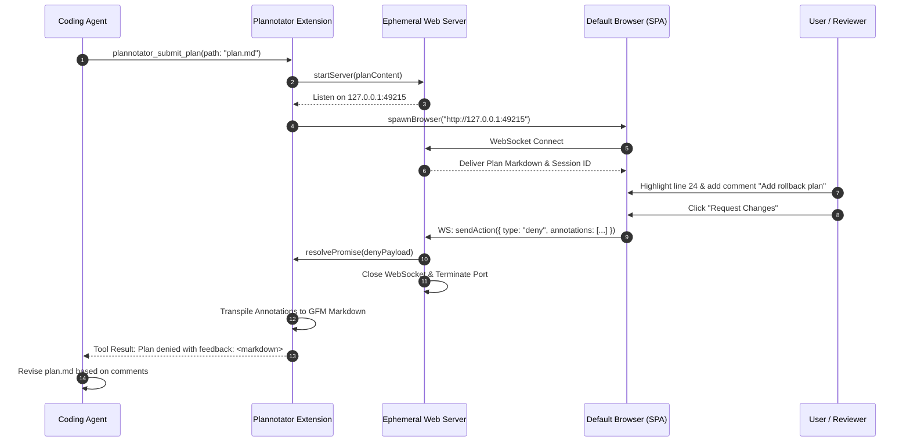

# 深度案例 07: @plannotator/pi-extension —— 人机协同评审与富视觉交互范式 (Visual Human-in-the-Loop & Annotation UI)

> **定位**: 生态最高星/最具代表性的交互式人机协同扩展 (Monthly Installs: 58K+)  
> **包名**: `@plannotator/pi-extension` (作者: backnotprop)  
> **源码坐标**: `~/.pi/agent/npm/node_modules/@plannotator/pi-extension/`  
> **核心标签**: Plan Mode 状态机、内置轻量 Web 服务器、浏览器双向标注流、Write 拦截熔断门、Prompt 缓存无损注入

---

## 1. 前后他要做什么 (Before & After Intent / Problem & Solution)

### Before (没有 Plannotator 时的割裂与失控)
在纯命令行/TUI 终端中，Agent 执行复杂任务往往面临两个极端的困境：
1. **失控狂奔 (Unchecked Autonomous Execution)**: Agent 产生了一个不切实际的方案（例如重构了核心数据库模型或误删了关键配置），直接在几秒钟内通过 `edit`/`write` 篡改了十几个文件，用户回过神来时局面已不可收拾。
2. **纯文本评审体验极差 (TUI Plan Review Fatigue)**: 原生终端如果要让用户评审长达数百行的方案或大型代码 Diff，用户只能在终端里反复翻页、上下滚动。终端文本缺乏上下文高亮、行内点选评论、折叠与富媒体渲染，用户很难提出精确到具体段落的结构化批注。

### After (引入 Plannotator 后的可视化协同中枢)
Plannotator 在 Pi 中建立了一套**人机共生、视觉驱动的双向审核流水线**：
1. **规划与执行双态隔离 (Plan Mode State Machine)**: 引入独立的 `planning` 模式。在规划阶段，Agent 被硬性限制只允许读代码与撰写 Markdown 方案，严禁修改任何生产源代码。
2. **零依赖浏览器富 UI 瞬时唤起 (Loopback Web UI)**: 当 Agent 完成方案并调用 `plannotator_submit_plan` 时，扩展瞬间在本地随机端口拉起内嵌 HTTP/WebSocket 服务，并在默认浏览器弹出一个极富交互感的批注工作台（基于 `@pierre/diffs` 和 `@plannotator/webtui`）。
3. **行内所见即所得批注 (WYSWYG Annotation & Approval)**: 用户可以在浏览器中划词选中方案段落、添加批注、修改步骤、单点拒绝或整体 Approve。
4. **结构化反馈回灌模型 (Markdown Feedback Re-injection)**: 用户点击提交后，Web 端批注通过 WebSocket 传回 Node 进程，由 Turndown 引擎转换为标准的 Markdown 批注列表，作为高优先级消息推送给 Agent 继续迭代。
5. **执行期清单追踪 (Execution Checklist Tracking)**: 一旦方案被批准进入 `executing` 模式，扩展自动解析方案中的 `[ ]` 任务清单，在每轮执行开始前向 Agent 同步 `[DONE:n]` 状态进度。

---

## 2. 影响面是什么 (Impact & Blast Radius)

Plannotator 跨越了 Node.js 进程、本地网络端口、操作系统默认浏览器以及 Pi 的多轮对话历史：

```
[Agent Planning] 
      │
      ├── 1. Tool Call Gate (pi.on("tool_call")) ──> [Block all non-MD writes]
      ├── 2. plannotator_submit_plan Tool Call
      │            │
      │            ▼
      ├── 3. Ephemeral Loopback Server (HTTP/WS on 127.0.0.1:RandomPort)
      ├── 4. OS Browser Launch (xdg-open / open / start)
      │            │ (Human reviews & annotates visually in browser)
      │            ▼
      ├── 5. WebSocket Ingestion & HTML-to-Markdown Transpilation
      └── 6. Conversation Suffix Injection (before_agent_start framing)
```

| 维度 | 影响面细节与控制约束 |
|---|---|
| **工具调用与写操作拦截 (Write Sandboxing)** | 在 `phase === "planning"` 期间，扩展深度挂载 `pi.on("tool_call")`。如果 Agent 试图调用 `write` 或 `edit` 修改非 `.md` / `.mdx` 文件，扩展直接返回 `{ block: true, reason: "..." }`，在系统调用前实行物理阻断。 |
| **Token 预算与 Prompt 缓存友善度** | **绝不修改 System Prompt**: Plannotator 绝不通过覆盖系统提示词来注入规则（那会彻底击穿 LLM 的 Prompt Cache）。它通过 `pi.on("before_agent_start")` 注入 `display: false` 的轻量级对话后缀消息（Framing），最大程度保留前缀命中率。 |
| **网络与操作系统端口** | 1. 严格绑定环回接口 `127.0.0.1`，分配随机未占用端口，拒绝跨网段暴露。<br/>2. 浏览器会话结束后，WebSocket 心跳超时或连接断开会自动触发服务端口安全回收，杜绝孤儿进程占用。 |
| **项目信任机制 (Project Trust)** | 严格遵循 Pi 0.79+ 的信任模型。非信任模式下，不加载用户项目根目录下的 `.pi/plannotator.json` 自定义偏好设置。 |

---

## 3. 利用了派的什么能力 (Pi Capabilities Exploited)

Plannotator 展现了 Pi 扩展作为「跨介质全功能协同应用」的无限潜力：

### (1) 生命周期钩子与状态同步
- `pi.on("tool_call")`: **方案期写操作熔断**。若处于规划阶段且修改非文档文件，直接拦截。
- `pi.on("before_agent_start")`: **阶段指引注入**。向 Agent 递送当前处于 `planning` 还是 `executing` 的角色预期，并在方案获批后注入当前待办清单的未完成项。
- `pi.on("turn_end")` / `pi.on("agent_end")`: **轮次收尾检查**。监测 Agent 是否完成了当前任务，或者是否需要唤起二次评审。
- `pi.on("session_compact")` / `pi.on("session_tree")`: **跨分支与压缩持久化**。当会话发生上下文压缩或树形分支跳转时，利用 `current-pi-session.ts` 恢复 Plan 状态机指针。
- `pi.on("resources_discover")`: **动态 Skill 发现**。按需向 Pi 的技能体系暴露 `plannotator` 核心技能。

### (2) 扩展工具注册 (`pi.registerTool`)
- `plannotator_submit_plan`: Agent 核心交付接口。Agent 编写完计划文件后调用该工具传入路径，触发浏览器评审流；该工具会进入异步挂起等待状态，直到人类在浏览器端点击「批准」或「驳回带批注」。

### (3) 交互式命令与快捷键 (`pi.registerCommand`, `pi.registerShortcut`)
- `/plannotator-plan-mode`: 命令行切换规划模式。
- `pi.registerShortcut(Key.ctrlAlt("p"))`: 为终端用户绑定热键 `Ctrl+Alt+P`，随时一键启动或退出规划模式。
- `/plannotator-review`: 对未提交的 Git Diff 唤起浏览器评审。
- `/plannotator-annotate`: 对指定 Markdown 文本唤起浏览器批注。
- `/plannotator-last`: 对 Agent 最近的一条 Assistant 消息调出评审界面。

---

## 4. 他自身做了什么能力 (Self-Provided Capabilities)

Plannotator 在扩展内部封装了一个完整的现代微 Web 应用体系：

```
                    ┌─────────────────────────────────────────┐
                    │      Plannotator Extension Core         │
                    └────────────────────┬────────────────────┘
                                         │
         ┌───────────────────────────────┼───────────────────────────────┐
         ▼                               ▼                               ▼
 ┌───────────────┐               ┌───────────────┐               ┌───────────────┐
 │ Plan State    │               │ Local Web     │               │ Annotation    │
 │ Machine       │               │ Server & RPC  │               │ Transpiler    │
 ├───────────────┤               ├───────────────┤               ├───────────────┤
 │- Idle         │               │- Node HTTP/WS │               │- Turndown     │
 │- Planning     │               │- Singlefile   │               │- GFM Plugin   │
 │- Executing    │               │  HTML Bundle  │               │- Pierre/diffs │
 │- Write Guard  │               │- Port Lease   │               │- Parse5 DOM   │
 └───────────────┘               └───────────────┘               └───────────────┘
```

### 1. 单文件嵌入式 Web SPA (`plannotator.html`, `review-editor.html`)
Plannotator 将复杂的 Web 前端（包含 Diff 高亮器、富文本编辑器、标注气泡框、WebSocket 客户端）预打包为单文件 HTML 资产（各十余兆，内联所有 JS/CSS/WASM/字体），彻底摆脱外部静态 CDN 依赖，在完全离线无网的环境下依然秒开。

### 2. Markdown <-> 富文本标注双向转译 (Annotation Transpiler)
人类在 Web 页面中通过富文本或所见即所得方式所做的涂改与评论，被扩展通过 `parse5` 和 `@joplin/turndown-plugin-gfm` 精准还原为结构化的标准 GitHub Flavored Markdown 引用块，使得 LLM 能像阅读自然对话一样理解批注：
```markdown
> [Line 42]: `db.execute("DROP TABLE users")`
**Reviewer Comment**: Do not drop the table! Use soft-delete column `deleted_at` instead.
```

### 3. Checklist 任务追踪解析引擎 (`generated/checklist.ts`)
扩展内置了状态驱动的清单解析器，能自动识别 Markdown 格式的待办项（`- [ ]`, `- [x]`），并在 Agent 执行每一步后动态更新方案原文件，确保任务进度单调递增。

---

## 5. 核心思想的代码逻辑结构 (Architecture & Code Logic Flow)

### 目录结构组织 (Folder Taxonomy)
```
apps/pi-extension/
├── index.ts                     # 扩展主入口 (Lifecycle, Tools, Commands, Hotkeys)
├── config.ts                    # 配置加载器与阶段 Profile 渲染
├── current-pi-session.ts        # 会话标识追踪与多会话隔离
├── assistant-message.ts         # 历史助理消息提取与快照捕获
├── plannotator-events.ts        # 内部事件分发总线与评审状态流
├── plannotator-browser.ts       # 浏览器启动子进程管理 (open/xdg-open)
├── server.ts                    # 本地 Node HTTP / WebSocket 静态资源分发
├── server/                      # WebSocket 通信协议处理与消息分发
├── todo-providers/              # 与不同待办管理工具的适配桥
├── generated/                   # 预生成的 Checklist 解析器与 Prompt 模版
├── plannotator.html             # 预编译方案评审独立 Web 应用
└── review-editor.html           # 预编译 Diff 代码审查独立 Web 应用
```

### 方案提审与评审运行时序列图 (Runtime Sequence Flow)



---

## 6. 测试资产与自动化测试考量 (Testing Assets & Strategy)

作为一个集成了浏览器、Websocket 和复杂文件拦截的混合扩展，Plannotator 的测试策略展现了高度的工程克制：

### 1. 无头离线评审模拟 (Headless Review Testing)
由于在 CI/CD 中无法弹开物理浏览器，Plannotator 将 Web 交互层与核心评审逻辑完全解耦：
- 测试套件直接对 `server.ts` 开启 WebSocket 客户端仿真连接。
- 模拟发送前端 Action 数据包（`approve`, `deny`, `annotate`），断言扩展状态机的流转与工具调用的返回值。
- 全程不需要真实启动 Chrome/Firefox，单次状态流测试在 50ms 内即可完成。

### 2. 状态机不变量测试 (State-Machine Invariant Testing)
针对 `idle` -> `planning` -> `executing` -> `idle` 的各种异常跃迁路径进行暴力分支覆盖：
- 规划期突发异常中断后重启会话。
- 执行期方案文件被外部 Git 操作覆盖。
- 确保在任何异常情况下，`pi.on("tool_call")` 的写操作阻断锁不会发生「死锁无法解除」或「误阻断正常编辑」。

### 3. Turndown Markdown 往返一致性测试 (Roundtrip Fidelity)
针对富文本标注的转译，维护了一整套复杂的 HTML -> Markdown 样本库，验证多级列表、代码块、内联高亮、表格在经过用户划词涂抹后，生成的批注 Markdown 绝对不会出现语法破坏或逃逸。

---

## 7. 面向 Coding Agent 的友好度 (Coding-Agent Friendliness / DX for AI)

Plannotator 对 Coding Agent 极为温柔且体贴，几乎所有交互都经过了 Agent 人机工程学设计：

### 1. 结构化错误指引与自我纠偏
当 Agent 在 `planning` 阶段犯错试图修改源代码时，拦截信息不是生硬的 `Permission Denied`，而是带有明确下一步动作的引导语：
```
Plannotator: during planning, writes are limited to markdown files (.md, .mdx) inside the working directory. 
Blocked: src/core/auth.ts. 
Next Step: Write your proposed changes into your plan markdown file first, then call plannotator_submit_plan.
```
这让 Agent 能够立即意识到自己的当前状态并纠正调用行为。

### 2. 缓存友好的 Framing 注入设计
Plannotator 的作者深谙大模型 Prompt Caching 的运作机制：
- 严格避免在系统提示词层面对大模型反复注入变化的方案状态。
- 将执行进度（Checklist 状态）作为上下文尾部的自然对话消息追加，使得模型对话历史的前半部分（即庞大的系统提示、工具定义和历史探索）能 100% 稳定命中底层 API 的 KV 缓存，大幅降低用户和 Agent 的等待延迟与费用开销。

### 3. 透明的完成度语义 ([DONE:n] Markers)
在方案执行阶段，Agent 只需要在其回复或思考中自然标注任务完成标记，扩展便能自动在后台对齐进度，无需 Agent 频繁调用繁琐的状态报告工具。

---

## 小结

`@plannotator/pi-extension` 代表了 AI 编程助手领域最高水准的**交互体验升级 (UX Paradigm Shift)**：它跳脱了纯终端字符流的桎梏，利用本地 Web 技术打造了一套安全、高带宽、符合人类直觉的评审中枢，同时通过极度克制的 Prompt 管理和文件拦截机制，为 Coding Agent 提供了坚实可靠的安全护栏。
