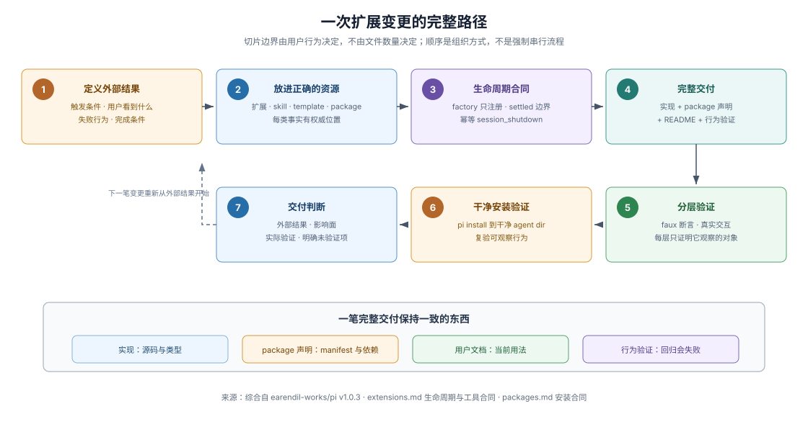
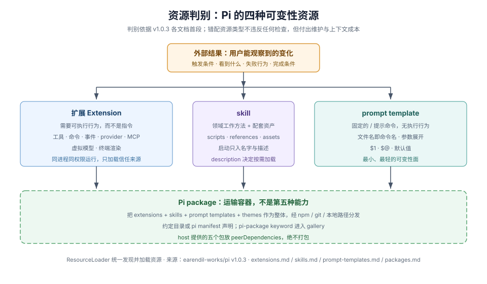

# Pi 扩展开发模型：资源、验证与交付判断

## 这卷解决什么问题

新建独立 Pi 扩展仓后，最容易出现的不是不会写 `pi.registerCommand()`，而是不知道怎样把用户意图、扩展实现、package 声明、测试结果和交付判断连成一条可复查的链。本卷给出一张 Pi-native 的总地图：变更落在哪种资源类型，哪种验证能证明什么，以及为什么「扩展能加载」「工具能执行」「干净环境能安装」是三个必须分别观察的结果。

这是依据 Pi `v1.0.3` 源码、文档与示例归纳出的开发模型，不是 Pi 官方宣布的方法名，也不是扩展仓必须复制的主仓库制度。正文区分运行时事实、主仓要求、扩展仓建议与仓库自定；扩展仓自行决定治理规则与验证适配。

## 一页总览：四个层次不要混成一件事

独立扩展开发同时面对四个层次。运行时接口回答「扩展怎样被加载、事件怎样流动」；仓库结构回答「源码、依赖和文档怎样组织」；发布形态回答「用户安装什么」；治理规则回答「谁评审、哪些检查必须通过」。Pi 的文档定义了运行时接口和组合机制，独立扩展仓需要为自己的仓库结构、发布形态和治理规则指定权威维护位置。

| 层次 | 主要问题 | Pi 能直接提供什么 | 扩展仓仍需自己决定什么 |
|---|---|---|---|
| 运行时接口 | factory 何时执行、事件按什么顺序、工具怎样被模型触达？ | `ExtensionAPI` 合同、事件生命周期、工具 exposure、MCP/虚拟模型注册 | 扩展自己的工具语义、错误模型和状态存储 |
| 仓库结构 | 源码、测试、文档、示例放在哪里？ | 单文件/目录扩展、`package.json` 依赖、示例库作为参考 | 独立仓布局、测试入口、README 结构 |
| 发布形态 | 用户经 npm、git 还是本地路径安装？ | Pi package 的发现规则、`pi` manifest、host 提供包清单 | 发布源、版本策略、兼容范围、升级说明 |
| 治理规则 | 谁评审、哪些检查是门槛、怎样决定发布？ | pi-mono 的规则可作为参考原则 | 自己的入口合同、测试义务、发布判断 |

**扩展能加载 ≠ 行为真实发生 ≠ 干净环境可安装 ≠ 交付判断已记录。**这些结果必须分别被观察和记录，逐级展开见下面的完成度阶梯。

## Pi-native 完成度阶梯

一次扩展交付会产生多个可分别观察的结果——文件是否被加载、能力是否注册、行为是否真实发生，这些边界来自 Pi 机制本身；下表把它们组织为七级阶梯，**七级划分与各级名称是本语料的归纳**，不是 Pi 文档中的官方分级。评估一次交付时，逐级问「这级被观察过吗」：

| 等级 | 观察什么 | 常见误判 |
|---|---|---|
| 1. 文件被加载 | factory 被执行、无扩展错误报告 | 加载成功不等于任何能力注册成功 |
| 2. 能力已注册 | 工具/命令/provider 出现在注册表；命令进入 `/` 补全，包资源的加载可经 `pi config` 配置 | 注册不等于模型会调用、命令会执行 |
| 3. 行为真实发生 | 真实会话中工具 `execute` 运行、命令 handler 运行、事件 handler 被派发 | 手工组装的 session 对象不经过发现与加载路径 |
| 4. 生命周期合同正确 | factory 不启动长命资源、`session_shutdown` 幂等、继续条件有守卫 | 一次性手动验证测不出并发、取消、reload 的边界 |
| 5. 多模式可用 | interactive、RPC、JSON、print 模式行为完整 | 只在 TUI 测过的 UI 调用在无 UI 模式会失败 |
| 6. 干净环境可安装 | `pi install` 到干净 agent dir 后同等可用，host 包走 `peerDependencies` | 开发目录能跑不代表 package 声明完整、依赖未漏 |
| 7. 交付判断记录 | 外部结果、影响面、验证命令、未验证项写进交付说明 | 任何一级的缺失都不应被「CI 绿了」掩盖 |

阶梯上每级都有 Pi 自己的验证方式：faux provider 断言事件与状态合同（第 3、4 级）、真实交互验证（第 3、5 级）、干净安装验证（第 6 级）。见[新仓起步](./01-new-extension-repository.md)的具体做法。

## Pi-native 变更路径

### 1. 先定义外部结果

从用户能观察到的结果开始，而不是从「我要注册哪个 API」开始。描述触发条件、用户看到或得到的结果、失败时的行为和完成条件。Pi 文档对扩展的判别就是外部行为导向的：

> Use one when a workflow needs tools, commands, event handlers, model providers, session state, or terminal UI rather than instructions alone.
>
> — Pi [Extensions 文档](https://github.com/earendil-works/pi/blob/v1.0.3/packages/coding-agent/docs/extensions.md#L3)

意图可以放在 issue、任务说明或 commit 说明里；它回答「为什么改、怎样算完成」，不拥有当前 API 或长期设计理由。扩展仓不必复制 pi-mono 的 issue 制度，只需让自己的任务入口能表达可观察结果。

### 2. 把变更放进正确的资源类型

Pi 用不同的资源类型承载不同种类的变化，`ResourceLoader` 统一发现并加载它们：

| 变化种类 | Pi 原生资源 | 判别 |
|---|---|---|
| 需要执行代码的行为 | 扩展（工具、命令、事件、provider、MCP、渲染） | 「needs … rather than instructions alone」 |
| 领域工作方法 + 配套脚本/参考文件 | skill | 比 prompt template 需要更多上下文，但不需要新执行点 |
| 固定的可复用提示命令 | prompt template | 同一 prompt 反复使用，无需执行行为 |
| 多个资源作为整体分发 | package | 经 npm/git 共享，或多个资源属于一体 |

资源判别来自 Pi 的 [Extensions](https://github.com/earendil-works/pi/blob/v1.0.3/packages/coding-agent/docs/extensions.md#L3)、[Skills](https://github.com/earendil-works/pi/blob/v1.0.3/packages/coding-agent/docs/skills.md#L3-L5) 与 [Prompt Templates](https://github.com/earendil-works/pi/blob/v1.0.3/packages/coding-agent/docs/prompt-templates.md#L3) 文档开头的判别句（Skills 的判别句在第二段）；错配资源类型（例如把一堆指令写成扩展）不违反任何检查，但会付出维护与上下文成本。

### 3. 遵守运行时生命周期合同

扩展的可用性受一组显式合同约束（运行时事实，依据 Extensions 文档）：

- factory 里不要启动进程、socket、watcher 或计时器——有些调用只加载扩展不开会话；长命资源从 `session_start` 或需要的命令/工具里启动。
- 一次 run 从 `before_agent_start` 经模型、消息、工具事件到 `agent_end`；自动重试、恢复、压缩或排队工作可以在其后继续。
- 压缩可由扩展参与：`session_before_compact` 事件在压缩前触发，扩展提供的自定义摘要记为 `fromHook: true`，其 LLM `usage` 计入会话统计（运行时事实，见 [Compaction 文档](https://github.com/earendil-works/pi/blob/v1.0.3/packages/coding-agent/docs/compaction.md#L150-L165)、[钩子事件](https://github.com/earendil-works/pi/blob/v1.0.3/packages/coding-agent/docs/compaction.md#L296)）。
- `agent_before_settle` 是最后一个可行动边界；`agent_settled` 是最终且仅通知的。
- 清理放进幂等的 `session_shutdown`，因为取消、reload、会话替换和进程退出会汇聚到同一路径。

违反这些合同的扩展往往在「手动跑一次」时看起来正常，在并发、取消或无头模式下失败。

### 4. 形成完整的一笔交付

完整的一笔交付不是「代码加一个绿测试」，而是把这笔变更影响到的实现、package 声明、用户文档、行为验证一起交付。交付边界由用户行为决定，不由文件数量决定：一个新命令进入 `/` 命令补全、或一个新工具改变模型可见的工具清单时，它的 README 段落、package manifest 条目和验证结果都属于同一笔交付。

### 5. 按观察对象选择验证方式

验证方式按观察对象分工，不是固定的 test-first 顺序（扩展仓建议，依据 Pi 的可复用机制）：

| 观察对象 | 验证方式 | 能证明 | 不能证明 |
|---|---|---|---|
| 程序合同（事件顺序、settled 边界、工具结果形状） | faux provider 脚本化测试 | 确定性的语义断言，无真实 API、无费用 | 真实模型会不会用对工具 |
| 真实交互 | 启动 Pi、提交真实 prompt、收到回复 | 扩展在真实会话中可见可用 | 确定性回归 |
| 安装形态 | 干净 agent dir 中 `pi install` 后复验 | package 声明、依赖、发现规则完整 | 多版本矩阵兼容 |
| 会话账本 | 事后读 session JSONL | 实际发生了什么（声明变化、压缩记录） | 逐字节网络记录或重放保证 |

Pi 主仓库的测试套件是这套分层的参考实现：它用发布的 `@earendil-works/pi-ai/compat` 导出的 faux provider 驱动真实 `AgentSession`，不碰真实 API、key 或网络。Pi 没有为第三方扩展提供托管评估；扩展仓的验证义务由自己建立，做法见[新仓起步](./01-new-extension-repository.md)。

### 6. 验证用户实际安装的形态

源码目录能加载，不代表 package 声明完整。只要扩展经 package 分发，就应在干净 agent dir 中安装并复验至少一个可观察行为；并遵守 Pi 的依赖合同：host 提供的包（`@earendil-works/pi-ai`、`@earendil-works/pi-agent-core`、`@earendil-works/pi-coding-agent`、`@earendil-works/pi-tui`、`typebox`）声明在 `peerDependencies` 用 `"*"`，绝不放进 `dependencies`——物理拷贝会绕过 Pi 的扩展模块映射，制造重复类和注册表（运行时事实，见 [Packages 文档](https://github.com/earendil-works/pi/blob/v1.0.3/packages/coding-agent/docs/packages.md#L80-L92)）。

### 7. 用交付判断收尾

交付记录列出：外部结果、影响面（哪些资源变了）、实际运行的验证与结果、明确未执行的检查。机器断言通过只说明它执行的断言通过；「扩展在某次会话里看起来能用」不构成第 3 级以上的证据。评审者（人或 agent）重新读取当前 diff、当前声明和当前文档，不沿用旧结论。

## 最重要的注意事项

### 不要把一次加载当成完成

`pi --extension ./hello.ts` 成功只覆盖阶梯第 1 级。交付判断要逐级核对，最低限度覆盖第 3 级（真实行为）与第 6 级（干净安装）。

### 不要在 factory 里建长命资源

见上文生命周期合同。需要配置抓取或 provider 注册的异步 factory 可以等待，但进程、socket、watcher 属于会话期资源。

### 不要只做手工组装的验证

直接 new 一个 session 对象或 mock 掉 ResourceLoader，测的是你的 mock，不是「扩展经发现、加载、信任、注册」的路径。faux provider 测试也要让扩展走真实的发现与加载。

### 不要假设 UI 存在

JSON、print 模式没有 UI；RPC 模式不能转发自定义终端组件。用 `ctx.mode === "tui"` 与 `ctx.hasUI` 守卫，并让工具与事件行为独立于渲染。RPC 模式下 `ctx.ui` 的对话框与通知方法经 extension UI 子协议请求/应答转发（此时 `ctx.mode === "rpc"` 且 `ctx.hasUI` 为 true），`custom()` 等终端专属方法不可用（运行时事实，见 [RPC Extension UI 文档](https://github.com/earendil-works/pi/blob/v1.0.3/packages/coding-agent/docs/rpc-extension-ui.md#L12-L25)）。

### 不要误解注销与终止

工具不能注销，只能以 `exposure: "hidden"` 重注册收回；`terminate: true` 需要同批每个已完成工具都同意才跳过自动后续；报告「带数据的失败」应返回 `isError: true` 而不是抛出。

### 不要把主仓治理当默认答案

pi-mono 的准入 gate、CI 矩阵与发布管线服务于它自己的仓库规模与风险。扩展仓借鉴其原则（例如「每个行为变化要有能在其回归时失败的最小检查」），但必须为自己的规模定义权威位置与门槛。适用边界见 [SDLC Reference 的边界页](../sdlc-reference/08-applicability-boundary.md)。

## 从新仓库开始

一个合理的第一笔交付是：一种可观察行为、一种明确的资源类型、一条经真实发现与加载的运行路径、一条在回归时会失败的检查、一份说明当前用法的 README，以及一次干净安装验证。具体路径见[新仓起步](./01-new-extension-repository.md)；术语先查[术语与心智模型](./02-terms-and-mental-models.md)。

## 相关入口

- [新仓起步](./01-new-extension-repository.md)：从最小扩展走到 package 分发与交付判断。
- [术语与心智模型](./02-terms-and-mental-models.md)：运行时、资源类型、发现、验证词汇。
- [SDLC Reference](../sdlc-reference/00-index.md)：pi-mono 的准入、检查、CI、发布精确条件。
- [Development Harness](../repo-harness/00-index.md)：pi-mono 自身的 agent 参与组织。
