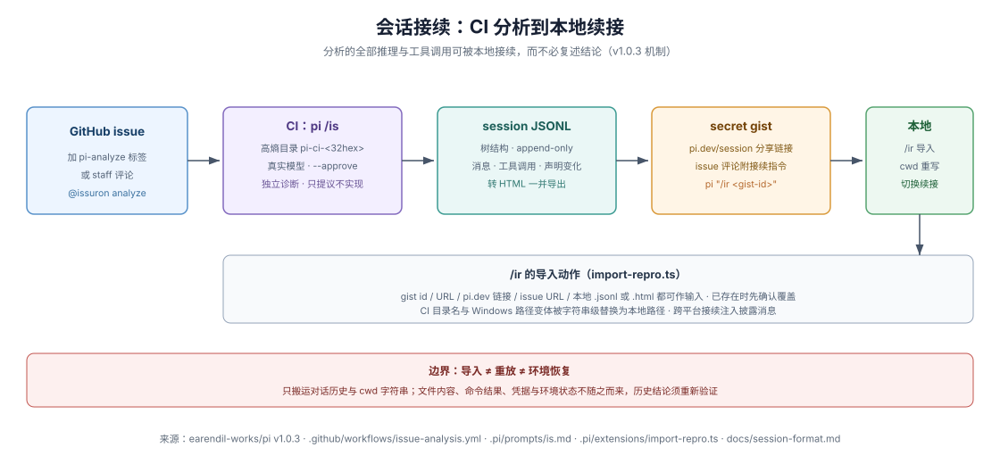

# 会话可检视性：JSONL 合同、会话树与 `/ir`

pi-mono 把「工作过程」当作可机读的一等对象：会话持久化为 JSONL 文件，树结构支持原地分支，CI 的 issue 分析会话可被 `/ir` 命令导入本地续接，作者还把日常工作会话发布为公开数据集。本页检视 `v1.0.3` 的这些机制。会话格式为运行时事实（对所有 Pi 用户有效）；`/ir` 扩展与 HF 数据集发布属 pi-mono 的自定实践。

## JSONL 合同要点

会话文件的合同定义在 `session-format.md`（运行时事实）：

> Sessions are stored as JSONL (JSON Lines) files. Each line is a JSON object with a `type` field. Session entries form a tree structure via `id`/`parentId` fields, enabling in-place branching without creating new files.
>
> — [session-format.md L3](https://github.com/earendil-works/pi/blob/v1.0.3/packages/coding-agent/docs/session-format.md#L3)

要点分列：

- **header**：文件首行是 `session` 类型的元数据行（版本、id、时间戳、`cwd`），不属于树（[session-format.md L64-L75](https://github.com/earendil-works/pi/blob/v1.0.3/packages/coding-agent/docs/session-format.md#L64-L75)）；`v1.0.3` 的当前版本为 3（`hookMessage` 角色更名为 `custom`），旧版本加载时自动迁移（[L24-L30](https://github.com/earendil-works/pi/blob/v1.0.3/packages/coding-agent/docs/session-format.md#L24-L30)）。fork/clone 出的会话在 header 里带 `parentSession` 指向母会话文件。
- **消息**：`message` 条目存 `AgentMessage`；assistant 消息记录产出它的 `provider`/`api`/`model`（及较新消息的 `thinkingLevel`）。**prompt 与工具声明的变化也走消息**：首个请求把全部 prompt 段落与工具声明存为一条 system 消息，后续变化存为按名 patch `sections` 并列出 `toolsAdded`/`toolsRemoved` 的 system 消息——按序重放即得当前 prompt 与工具集，没有独立的 prompt 状态条目（[session-format.md L80](https://github.com/earendil-works/pi/blob/v1.0.3/packages/coding-agent/docs/session-format.md#L80)）。
- **compaction 记录**：上下文压缩生成 `compaction` 条目，存摘要、`firstKeptEntryId`（压缩后保留区间的起点，必填）与可选的完整 system 检查点；重建上下文时，起点之前的条目被摘要替换（[session-format.md L123-L137](https://github.com/earendil-works/pi/blob/v1.0.3/packages/coding-agent/docs/session-format.md#L123-L137)）。
- 其它条目类型覆盖完整的工作面：`model_change`/`thinking_level_change`、`usage`（如 cache warming 的 token 归账）、`context_edit`（对早先上下文条目的 append-only 改写，原始历史不变）、`branch_summary`、`custom`（扩展状态，不进 LLM 上下文）、`custom_message`（扩展注入、进上下文）、`label`、`session_info`。

条目类型速查：

| 条目 | 记什么 | 进 LLM 上下文 |
|---|---|---|
| `session`（header） | 版本、id、`cwd`、可选 `parentSession` | 否（元数据） |
| `message` | 对话消息；system 消息承载 prompt 段落与工具声明变化 | 是 |
| `compaction` | 摘要 + `firstKeptEntryId` + 可选 system 检查点 | 折叠式进入 |
| `context_edit` | 对目标条目的替换或删除（append-only） | 改变未来上下文 |
| `branch_summary` | 被弃分支的 LLM 摘要 | 是（以 branchSummary 角色） |
| `usage` | 非 assistant 消息的 token/成本归账 | 否 |
| `custom` / `custom_message` | 扩展持久状态 / 扩展注入消息 | 否 / 是 |

## 会话树与分支

每个非根条目经 `parentId` 指向父条目；从任意早先条目长出新子树即原地分支，不必新建文件（运行时事实）。`/tree` 切换分支时可生成被弃路径的 LLM 摘要（`branch_summary`）。上下文构建沿「当前叶到根」的路径走，遇 compaction 按保留区间折叠，再应用最新的 `context_edit`——**原始条目永不被改写**，一切变化以追加条目表达。这意味着「探索了什么、放弃了什么、为什么」都留在账本里。

## `/ir`：把 CI 分析会话导入本地续接

pi-mono 的 issue 分析 CI 会把分析会话分享为 gist；`.pi/extensions/import-repro.ts` 注册的 `/ir` 命令把它取回本地（主仓自定实践）：

> The CI job runs in a high-entropy checkout directory; this command rewrites the recorded cwd to the local checkout, installs the session file into the current session directory, and switches to it.
>
> — [`.pi/extensions/import-repro.ts` L5-L7](https://github.com/earendil-works/pi/blob/v1.0.3/.pi/extensions/import-repro.ts#L5-L7)

机制要点（依据该文件 `v1.0.3` 版本）：

- 接受 gist id、gist URL、`pi.dev/session` 分享 URL、issue URL 或本地 `.jsonl`/`.html` 文件；issue URL 会翻找 bot 评论里最新的 gist 链接。
- **cwd 重写**：CI 的 checkout 目录名（`pi-ci-<32 位十六进制>`）与路径的各种 Windows 变体（盘符、反斜杠、MSYS 形式）都被字符串级替换为本地 checkout 路径，使会话里的绝对路径引用在本地有效。
- **跨平台提示**：源会话与本地平台不一致时，切换后注入一条 `customType: "import-repro"` 的自定义消息，明说「该会话在非 Windows 机器上续接，路径现为 Unix 风格」（[import-repro.ts L192](https://github.com/earendil-works/pi/blob/v1.0.3/.pi/extensions/import-repro.ts#L192)）——不假装无缝，而是把不连续性披露进上下文。

`/ir` 展示了会话可检视性的回报闭环：CI 在一次性环境里做的分析，其全部推理与工具调用可被人或 agent 在本地接续，而不必复述结论。

## 会话作为公开数据

仓库 README 的「Share your OSS coding agent sessions」节邀请 OSS 工作者分享会话——真实任务、工具使用、失败与修复优于玩具基准——并给出作者自己的实践（主仓自定实践）：

> I regularly publish my own `pi-mono` work sessions here:
>
> — [README.md L152](https://github.com/earendil-works/pi/blob/v1.0.3/README.md#L152)

其后链接到 Hugging Face 上的 `badlogicgames/pi-mono` 数据集（[README.md L154](https://github.com/earendil-works/pi/blob/v1.0.3/README.md#L154)）。也就是说：本卷检视的这套机制，其产出本身被当作训练与研究材料公开。

## 边界：会话账本不是什么

会话文件是**结构化的工作账本**，但有三件事它不能证明（本语料归纳，非 Pi 声明）：它不是逐字节的网络记录——`provider_stream_event` 等原始流事件不持久化，`context_edit` 意味着模型看到的上下文与原始历史可以不同；它不是确定性重放——重放需要真实 provider 凭据与外部世界状态，会话只记录请求与响应；它不是完整性证明——条目可被任何能写文件的进程编辑。把这些误当审计日志会高估它的证据等级；把它当「可读、可分支、可续接的工作记忆」则是准确的。
