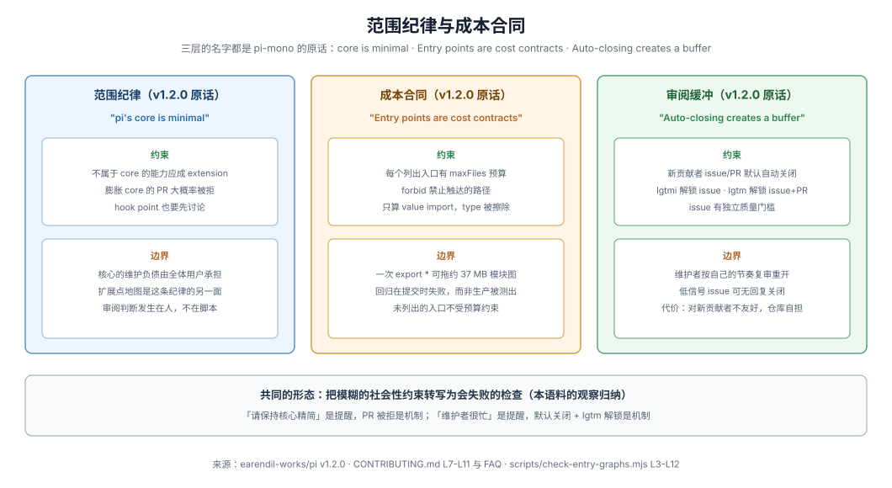

# 范围纪律与成本合同：minimal core、cost contracts 与审阅缓冲

pi-mono 用三层机制控制「仓库变大、变慢、变得没人能维护」：范围纪律（什么不该进核心）、成本合同（进了核心的东西多大）、审阅缓冲（维护者的时间是稀缺资源）。三层的名字都来自仓库自己的原话：`CONTRIBUTING.md` 的 **pi's core is minimal**、`check-entry-graphs.mjs` 注释的 **Entry points are cost contracts**、FAQ 的 **Auto-closing creates a buffer**。本页检视这三层。**范围纪律与贡献门槛是主仓要求**；成本合同是主仓的工程实践；借鉴部分为扩展仓建议。

## 范围纪律：不属于 core 的应成 extension

`CONTRIBUTING.md` 开篇即划定核心的边界（主仓要求）：

> First things first: **pi's core is minimal**.
>
> —

> If your feature does not belong in the core, it should be an extension. PRs that bloat the core will likely be rejected.
>
> —

它紧接着说明理由：核心的存在意义就是最小且可被 extension 影响与操纵，但连扩展的 hook point 也应经充分讨论，避免不可维护的膨胀与复杂交互。这不是审美偏好，而是把「每进核心的一份代码都是全体用户的永久维护负债」制度化。资源类型地图（见 [04](./04-extension-points-map.md)）是这条纪律的另一面：正因为核心拒绝吸收新能力，才需要一张完整、稳定的扩展点地图。

[E111](../_evidence/render.md#e111)

## 成本合同：exports 的图预算

范围纪律管「进不进」，`scripts/check-entry-graphs.mjs` 管「进了之后多大」。它把包的 `exports` 地图当作成本契约执行（主仓实践）：

> Entry points are cost contracts.
>
> —

文件头注释给出了动机：一个多余的 `export *` 能让一个 1 文件的纯函数入口拖动整个 barrel——经 barrel 导入要付出约 37 MB 的模块求值图，而且直到有人测量之前什么都不失败。脚本遍历每个声明入口的值导入图（`import type` 被擦除、不计入），对列出的入口强制 `maxFiles`、`forbid` 与可选 `allow` 预算：`packages/ai` 的 `./models` 入口限 **20** 文件、禁触 `providers/`、`models.generated.ts` 等，并 `allow` `packages/telemetry/src/index.ts`（完整清单见下表）；`./utils/*` 限 3 文件；`packages/durable` 的根入口限 **73** 文件且禁触 `packages/ai/src/index.ts`。

[E112](../_evidence/render.md#e112)

预算全景：

| 入口 | maxFiles | forbid（禁止触达） |
|---|---|---|
| `packages/ai` → `./models` | **20** | `providers/`、`models.generated.ts`、`index.ts` 等；`allow` telemetry |
| `packages/ai` → `./utils/*` | 3 | `providers/`、`api/`、`index.ts` |
| `packages/durable` → `.`（根入口） | **73** | `packages/ai/src/index.ts`、typebox helpers |

预算的边界同样是显式的（主仓实践）：

> Budgets are deliberate. Entries with no budget remain unbounded; each listed entry states the graph it is allowed to reach.
>
> —

也就是说**预算只覆盖列出的入口**：未被列出的入口不受检查，这不证明它们轻，只证明尚未被纳入契约。该脚本由 `npm run check` 驱动，回归在提交时失败而非在生产中被测量出来（脚本注释原话是 "fails at commit time instead"）。

## 审阅缓冲：维护者时间是稀缺资源

第三层成本是维护者的审阅时间。pi-mono 收到的 issue 超出维护者能实时评审的量，因此贡献门槛把审阅节奏的决定权交给维护者（主仓要求，见 [01](./01-agent-entry-rules.md)）：新贡献者的 issue 与 PR 默认自动关闭、维护者每日复审并 reopen 达标者；issue 有质量门槛（短、具体、值得读、自己的语气）；大量自动化提交会被封号。FAQ 给出的理由（主仓原话）：

> Auto-closing creates a buffer so maintainers can review the tracker on their own schedule and reopen the issues that meet the quality bar.
>
> —

[E113](../_evidence/render.md#e113)

这是把「审阅成本」当作真实资源并显式定价的例子——代价是对新贡献者不友好，这一取舍由仓库自担。

## 组装、升级与上下文成本

对扩展作者，成本还出现在另外三处（运行时事实）：

- **组装成本**：第三方 package 可以执行扩展代码、其 skills 可以指示模型运行程序，因此安装前须审阅源码——「Review third-party package source before installing it. Review project package declarations before granting project trust.」。信任不是假设，是用户动作。
- **升级成本**：lockstep 版本纪律（全包同版本、一起升级，见 [03](./03-repo-skills.md)）把「多包版本矩阵」这个升级成本源直接消除。
- **上下文成本**：skills 只把名字、描述与路径放进系统提示、完整指令按需加载（见 [03](./03-repo-skills.md)）；会话 compaction 与 `context_edit` 控制历史进入模型上下文的体积（见 [05](./05-session-inspectability.md)）。宿主提供的包（`@earendil-works/pi-ai`、`@earendil-works/pi-agent-core`、`@earendil-works/pi-coding-agent`、`@earendil-works/pi-tui`、`typebox`）声明为 `peerDependencies` 且禁止打包，否则在编译 ESM 下会绕过 Pi 的模块映射、制造重复类与注册表。

[E114](../_evidence/render.md#e114)

## 观点：约束从提醒变成检查

观点（扩展仓建议，本语料归纳）：这三层的共同形态是——**把模糊的社会性约束转写为会失败的检查**。「请保持核心精简」是提醒，膨胀核心的 PR 被拒是机制；「别让入口拖进一堆模块」是提醒，超预算的入口在提交时打印完整文件清单并失败是机制；「维护者很忙」是提醒，默认关闭加 `lgtm` 解锁是机制。检查何时触发（提交时、PR 时、每日、tag 时）与检查内容本身同等重要。扩展仓不必复制具体预算数字或门槛值，但「约束写成会失败的检查」这一形态几乎可以原样搬走（仓库自定范围）。
