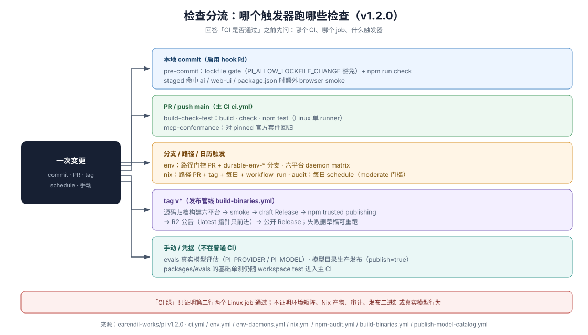

# 04 CI 矩阵：每个检查的触发器与分流

pi-mono 的质量检查不是单一「全仓检查」按钮，而是按事件与路径分流的一组工作流。回答「CI 是否通过」之前先问「哪个 CI、哪个 job、什么触发」。基线与逐条证据见 `../_evidence/render.md`。

## 主 CI：ci.yml

触发：push 到 `main`、面向 `main` 的 PR。两个 job：

[E034](../_evidence/render.md#e034)

- **build-check-test**（单 Linux runner）：Node 22、系统依赖（cairo/pango 图形库、fd、ripgrep）、`npm ci --ignore-scripts`、`npm run build`、`npm run check`（[03 页](03-check-pipeline.md)）、**`npm run build:daemon --workspace packages/env`**、`npm test`。

  其中 daemon 构建步骤是 v1.2.0 新增：pi-env 的 Rust daemon 在 v1.2.0 起进入主 CI 路径，因此 `packages/env` 的测试不会跑到一个未构建的 daemon 上。**v1.0.3 的 ci.yml 没有这一步**（本页旧版曾据此描述）。

- **mcp-conformance**（独立 Linux runner，）：工作流内注释说明其性质：

  > Runs pi's MCP client from source against the pinned official conformance suite and fails on regressions against packages/coding-agent/test/mcp-conformance/baseline.json.

  
  即协议兼容是普通 PR CI 的独立质量边界，不被「npm test 已覆盖」概括。

[E035](../_evidence/render.md#e035)

根 `npm test` 的构成：先 `node --test scripts/*.test.mjs scripts/*.test.ts`（脚本自身的单测），再 `npm run test --workspaces --if-present`。因此每个 workspace 包自己的 `test` 脚本都随主 CI 执行——包括 `packages/evals` 的基础单测（它的 `test` 是 `vitest run --config vitest.test.config.ts`，，与需要真实模型的 `eval`/`eval:host`/`eval:docs` 脚本是两回事，）。

[E036](../_evidence/render.md#e036)

## 专门工作流

### env.yml（环境多平台检查）

工作流名是 `Environments`（**v1.0.3 时名为 `Durable env`、文件名为 `durable-env.yml`**）。v1.2.0 的触发面扩大为三类：

- push 到 `main` 或 `durable-env-*` 分支（旧的分支约定保留），**限路径** `packages/durable/src/env/**`、`packages/durable/src/tools/**`、`packages/durable/test/env-*`、`packages/env/**`、以及两个 env 工作流文件自身；
- 面向 `main` 的 PR，同样限这些路径；
- 手动 `workflow_dispatch`。

即它从 v1.0.3 的「工作分支检查、不在普通 PR 上跑」变成了**路径门控的 PR 检查**。**四个 job**（`daemons`、`check`、`release-daemons`、`tests`）：

- **daemons**：复用 `env-daemons.yml`（`uses: ./.github/workflows/env-daemons.yml`），为每个受支持平台/架构原生构建 pi-env daemon 并上传为 `pi-env-<platform>-<arch>` artifact。
- **check**：`needs: daemons`；Linux 上完整 build、check，下载 daemon artifact 到 `packages/env/bin`，再校验 `npm pack` 的文件清单**恰好**包含 `dist/*`、`README.md`、`CHANGELOG.md`、`docs/protocol.md` 与八个平台的 `bin/pi-env-<name>/pi-env[.exe]`，且不含 `src/`、`daemon/`、`test/`。
- **release-daemons**：`needs: daemons`；**六平台** matrix `ubuntu-latest`(linux-x64)、`ubuntu-24.04-arm`(linux-arm64)、`macos-latest`(darwin-arm64)、`macos-latest`(darwin-x64，走 Rosetta)、`windows-latest`(windows-x64)、`windows-11-arm`(windows-arm64)，对 daemon 的**发布构建**跑 pi-env 测试。
- **tests**（先前遗漏，2026-10-14 轮次 0011 补入）：`fail-fast: false`，**五** OS matrix —— `ubuntu-latest`、`ubuntu-24.04-arm`、`macos-latest`、`windows-latest`、`windows-11-arm`。跑 cargo fmt/clippy/test（desktop 配置）、构建 daemon、跑 durable env 测试与 pi-env 测试，并在 Linux 上先装 OpenSSH server 以覆盖 bootstrap 测试（`if: runner.os == 'Linux'` → `command -v sshd || test -x /usr/sbin/sshd || (sudo apt-get update && sudo apt-get install -y openssh-server)`）。**它是 v1.0.3 `env-tests` job 的改名续存体**（同为五 OS matrix），不是新增能力。

[E037](../_evidence/render.md#e037)

> 与 v1.0.3 的差异不止改名：v1.0.3 是 `check`（Linux 上 build/check/durable vitest）+ `env-tests`（**五** OS matrix）；v1.2.0 是 `daemons` + `check`（加了 pack 清单校验）+ `release-daemons`（**六**平台，且构建的是发布形态的 daemon）+ `tests`（**五** OS matrix，即 `env-tests` 的续存体）。**订正**：本节曾写作"三个 job"并漏掉 `tests`，据此得出的"`check` + `env-tests` → `daemons` + `check` + `release-daemons`"这条 delta 也是错的——`tests` 在 v1.0.3 与 v1.2.0 都存在，只是改了名。

### nix.yml

触发五类：`v*.*.*` tag、面向 `main` 且命中 Nix/lock/package/install-lock/model-catalog 相关路径的 PR、`Publish Model Catalog` 工作流成功后的 `workflow_run`、每日 schedule（catch 无 PR 直推 main 的打包漂移）、手动。行为：pin job 在非 tag 场景刷新 stale 的模型目录 pin；**现行比对判据已扩为 `provider/type/api` 模型组**（不再只看 type），tag 上 pin 不可改；build job 在 x86_64-linux/aarch64-linux/aarch64-darwin 三系统 `nix build`，x86_64-linux 上另跑 `nix flake check --all-systems --no-build`，然后对产物跑 `pi --version`/`--help` smoke，tag 构建还要求 `--version` 输出恰等于 tag 版本号；tag 全系统成功后 `update-stable` 把 `stable` 分支**非强制 fast-forward** 到 release commit——注释明确「stable 永不回退到旧 release」；非 PR 的 main 上 pin 有更新时由 bot commit 回 main。

[E038](../_evidence/render.md#e038)

### npm-audit.yml

触发是每日 schedule（`37 7 * * *`）与手动 dispatch，不在任何 PR 上跑。步骤：`npm ci --ignore-scripts --no-audit --no-fund`、`node scripts/npm-audit.mjs`（production-only audit）、`npm audit signatures --omit=dev`。`npm-audit.mjs` 的门槛与豁免规则：audit level 为 `moderate`，未接受的 moderate 及以上 advisory 失败；已接受 advisory 必须匹配包名并给出不适用理由，条目过期（修复版已装）时警告要求清理。它验证 registry 签名与生产依赖漏洞面，不证明源码安全。

[E039](../_evidence/render.md#e039)

### publish-model-catalog.yml（数据发布链）

模型目录（pi.dev 运行时可见的模型元数据）是独立于 npm 代码发布的数据链，generate 与 publish 分离：

- 触发：CI 成功后（workflow_run，限 main）、命中相关路径的 PR（只 generate）、工作日 UTC 8–13 点每小时的 schedule、手动。
- **generate** job：`npm ci --ignore-scripts`、生成 JSON、`check:model-catalog` 校验、**`check:model-catalog-compat`（近期新增）**、上传 artifact——PR 上只到这一步。兼容检查取最新 npm release 的 tag 源码 + tarball 的 `dist/providers/data`，叠上新目录后对那版 pi-ai 跑 `tsc`；它需要 `fetch-depth: 0`，release 早于 `MINIMUM_PI_VERSION` 时跳过。**这是「已发布客户端会直接读到新目录」的防线**。
- **publish** job：需要 schedule/workflow_run 或手动且 `inputs.publish=true`；另有 Europe/Vienna 工作日 10:00–15:00 的发布窗口限制，schedule 只允许 10/12/14 点（手动 publish 可越过，）。发布脚本（`scripts/publish-model-catalog.mjs`）拒绝：缺 `anthropic`/`openai`/`openrouter` 任一必需 provider、provider shard 与全量目录不一致、重复 model identity、legacy 目录不是 chat 投影、chat 模型数少于 500；以全量目录的 SHA-256 作为 revision；revision 已是当前时不重复上传，先传 immutable revision 对象、最后传 no-store index。

[E040](../_evidence/render.md#e040)

## 「不在普通 PR CI」清单

以下检查存在，但触发器不在普通 push `main`/PR `main` 的主 CI 内（**主仓要求**，逐条以上文引用为证）：

1. pi-env daemon 的**六平台发布形态**测试（`env.yml` 的 `release-daemons`；注意该工作流自 v1.2.0 起是**路径门控**的，改到 `packages/env/**` 等路径时会在 PR 上跑，其它 PR 不跑——所以它不在主 CI 内，但也不再是"只在工作分支上跑"）；
2. Nix build、flake check、`stable` fast-forward（路径触发的 PR + tag + schedule + workflow_run）；
3. npm production audit 与 registry 签名校验（每日 schedule/手动）；
4. 发布二进制的多平台 smoke、npm 发布、packed consumer 安装验证（tag 管线，见 [07 页](07-release-and-recovery.md)）；
5. 真实模型行为评估（`npm run eval`/`eval:host`/`eval:docs`，需要 `PI_PROVIDER`/`PI_MODEL`，主 CI 命令清单里没有它们，）；

[E041](../_evidence/render.md#e041)
6. `.husky/pre-commit` 与 lockfile commit gate（本地 hook，见 [03 页](03-check-pipeline.md)）。

## 反例

- 「CI 绿」只证明 build-check-test 与 mcp-conformance 两个 Linux job 通过，不证明上表六类检查通过，更不证明真实模型行为、Nix 产物或发布二进制可用。
- **路径门控 ≠ 每次必跑**：`env.yml` 只有改动 `packages/env/**`、`packages/durable/src/env/**`、`packages/durable/src/tools/**`、`packages/durable/test/env-*` 或它自身时才会触发。"CI 绿"在一次只改文档的 PR 上并不包含 env 检查。
- workspace `test` 脚本随主 CI 运行 ≠ evals 的真实模型评估随主 CI 运行；`packages/evals` 的普通单测跑，`eval:*` 不跑。
- schedule 类检查（audit、Nix pin）只在触发时刻对当时状态成立，不随每个 commit 更新。
- 以上分流是 pi-mono 的**主仓要求**；独立扩展仓的 CI 触发设计是**仓库自定**，可参考「按变更路径分流重检查」的思路（[08 页](08-applicability-boundary.md)）。
